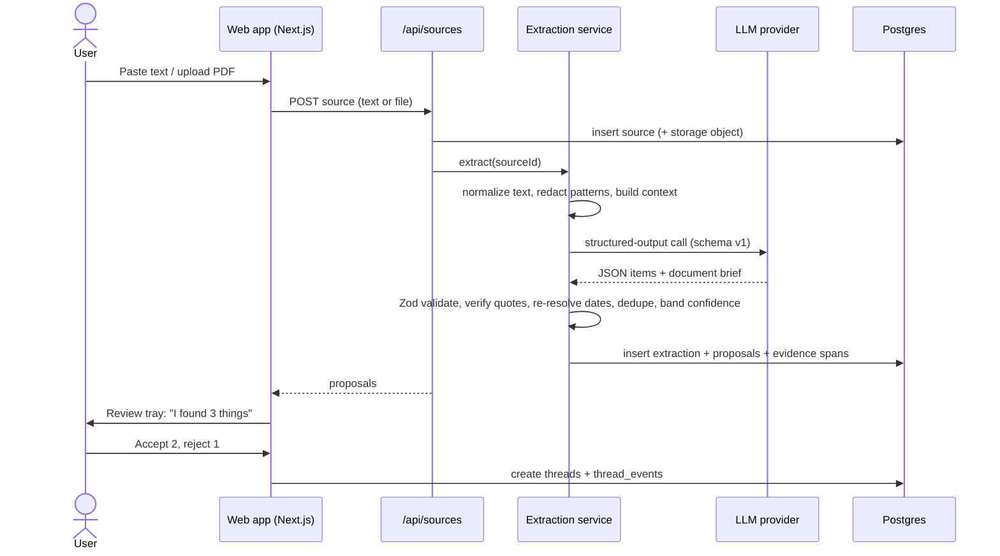

# Loose Ends — Product Requirements Document

Oct 2, 2026 · @Tasso Z · **Revised v1.1 — Oct 18, 2026** · *Oct 28: no Build Fest submission; a learning project with no deadline and no public demo (D62)*

> **v1.1 change note.** This revision reconciles the PRD with the content model, site contract and visual design standard. Every change is listed in [Decisions Log (v1.1)](#decisions-log-v11). Each change applies a recommendation from the cross-document review. Any of them can be overturned by editing the log and the affected sections together. Lost embedded diagrams are replaced with text equivalents.

## Executive Summary

Build one thing in 30 days: paste or upload something messy, and Loose Ends turns it into a small number of source-backed Life Threads you can review, act on, resolve, and later ask "why did I do that?" about.

The brief describes four capabilities (Don't Forget, Life Admin Copilot, Explain → Act, Decision Memory). This PRD collapses them into **one object and one loop**, because four pillars is a positioning problem and a scope problem:

```
Capture  →  Understand  →  Review  →  Thread  →  Resolve  →  Remember
(paste/upload)  (extract + explain)  (you decide)  (Life Thread)  (done/decided)  (decision note)
```

The three most important changes this PRD makes to the original concept:

1. **Every extraction is a proposal, not a fact.** In the MVP nothing the AI finds in a pasted source becomes a thread until the user accepts it in a review tray. This is the main trust mechanism and the main false-positive defense.
2. **Every AI claim must carry a verbatim quote that the server verifies exists in the source.** Items without a verified quote are discarded. Dates are re-resolved deterministically and flagged when the model and the parser disagree.
3. **The honest weak point is capture.** "Don't make me remember what I told myself I'd do" is undermined if the user must remember to paste things in. The MVP accepts this limitation, names it, and adds the cheapest possible capture improvement (an email-forwarding address) as a SHOULD HAVE.

What ships for Build Fest: paste/upload/quick-add input, structured extraction with verified evidence, a review tray, Life Threads with a simple lifecycle, an Explain card that separates source facts from AI interpretation, a Today view capped at a few items, resolve-with-reason, an "Ask why" answer grounded in stored decisions, and real deletion.

What does not ship: Gmail/Outlook/calendar integrations, mobile apps, push notifications, a general chatbot, vector search, teams.

## Problem Statement

Adults lose track of open loops because the loops live in many places and no single system holds them with their context.

- **Commitments are made in conversation, not in task apps.** "I'll send it Friday" is typed into an email or chat and never copied anywhere. The person who forgets is usually not lazy; the commitment never entered a system.
- **Life admin arrives as dense documents.** Renewal notices, benefit letters, and bills bury the one action and one date that matter under pages of boilerplate. People either act late or pay to not read carefully (auto-renewals at higher prices).
- **Task managers require upkeep.** They work for people who maintain them. Most people abandon them within weeks because the cost of entering and grooming tasks exceeds the perceived benefit.
- **Decisions lose their reasons.** Six months later, "why did we pick this insurer / plan / contractor?" is unanswerable, so people re-research or second-guess.

The gap: a system that does the entering and the reading for you, shows its evidence, and asks for confirmation instead of guessing silently.

**What is not the problem:** people do not lack reminder apps, calendars, or AI chat. Any solution that is "a reminder app with AI" or "a chatbot with memory" competes with free, built-in tools and loses.

## Product Vision

**Vision (2–3 years):** Loose Ends is the ledger of your open loops — every promise, request, deadline, and decision you're carrying — assembled automatically from the places you already communicate, each with receipts, and kept quiet unless something actually needs you.

**MVP vision (30 days):** Drop in anything messy. In under 30 seconds, get back 1–5 Life Threads, each with what it is, what to do, by when, and the exact sentence it came from. Resolve them, and optionally leave yourself a note on why.

**What Loose Ends is not:**

| It is not | Because |
| --- | --- |
| A task manager | No projects, subtasks, priorities, tags, or kanban. A thread has one next action. |
| A chatbot | There is no open-ended chat. The only free-text question is "Ask why," answered strictly from stored records. |
| A reminder app | It reminds only when a thread is due, unresolved, and above a confidence floor — at most once a day. |
| An archive of your life | It stores evidence excerpts needed to justify threads, and lets you delete sources after extraction. |

## Target Users

The MVP targets one person: a busy adult who juggles work and personal obligations, receives more text than they can read carefully, and does not maintain a productivity system.

To be useful in a manual-input MVP, they must also have a **moment where they review a pile of stuff** — a Sunday evening, a morning inbox pass, a stack of mail. That moment is when they'll paste things in. Users without that habit will not get value until automatic capture exists (post-MVP).

**Explicitly not targeted in the MVP:** teams, managers tracking reports' commitments, enterprise compliance, people who already run a disciplined GTD/Notion system (they will find it redundant), and anyone who needs it to watch their inbox automatically.

## Jobs To Be Done

| When… | I want to… | So that… | MVP coverage |
| --- | --- | --- | --- |
| I get a dense letter, bill, or notice | know what it is, what I must do, and by when | I don't miss a deadline or pay for not reading it | Full (Explain card) |
| I promise someone something in a message | have that promise tracked without retyping it | I don't become the person who forgets | Partial (only if I paste or forward it) |
| I'm waiting on someone else | see what's still outstanding | I can nudge them before it becomes my problem | Full (Waiting status) |
| I make a decision with tradeoffs | capture why in one sentence | future me doesn't redo the research | Full (resolve-with-reason) |
| I sit down to "get on top of things" | see the 3–5 things that actually matter | I can act instead of triage | Full (Today view) |
| I wonder why I'm being reminded | see the original sentence and the logic | I can trust it or correct it | Full (Why panel) |

## User Personas

| Persona | Context | Main pain | What wins them | What loses them |
| --- | --- | --- | --- | --- |
| **Priya, 38, operations manager and parent of two** | 150+ emails a day, school forms, two calendars, aging car and house | Things she agreed to in passing slip; renewal notices pile up unread | A Sunday-night "paste the pile" session that yields 4 clear threads | Being shown 20 items; any reminder that's wrong twice |
| **Marcus, 29, freelance designer** | Clients across email, Slack, and text; no assistant | Promised deliverables and unpaid invoices he's waiting on | "Waiting on" threads for invoices; commitment detection from pasted client threads | Having to tag, categorize, or set priorities |
| **Elena, 52, handling her father's affairs** | Medicare letters, pharmacy notices, bank forms for someone else | Dense documents she can't afford to misread | Explain card with explicit "not sure about" section and source quotes | Any confidently wrong date or dollar figure |

Elena is the strongest MVP persona: her inputs are documents (no integration needed), the stakes justify careful reading, and the trust features are visibly valuable. Marcus is the strongest post-MVP persona once forwarding and integrations exist.

## Core User Journeys

**J1 — Paste a messy message (commitment detection).** User pastes an email thread. Loose Ends asks which participant is them if it can't tell. Within \~15 s the review tray shows "I found 3 things": two pre-selected high-confidence items and one "maybe" item. User accepts two, rejects one. Two threads appear in Today.

**J2 — Upload a document (Explain → Act).** User uploads an insurance renewal PDF. The thread opens on an Explain card: what this is, what you need to do, by when, what happens if you don't, worth considering, not sure about. Each factual line links to its quote in the source.

**J3 — Quick add.** User types "Send Mike the proposal Friday" in the global input. It runs through the same extraction pipeline; because the user authored it as an instruction, a high-confidence result becomes a thread immediately (no review tray), with an undo toast.

**J4 — Daily check.** User opens the app (or the optional daily email). Today shows at most 5 threads ranked by urgency, each with a one-line reason ("Due tomorrow — you told Mike Friday"). Nothing else competes for attention.

**J5 — Resolve with reason.** User marks the insurance thread resolved and picks "I decided." A sheet asks "What did you decide?" and "Want me to remember why?" (optional, skippable in one tap).

**J6 — Ask why.** Months later the user asks "Why did I choose this insurance?" The answer quotes their own note, its date, and the source document, and says plainly if no reason was recorded.

**J7 — Correct or forget.** User edits a wrong date (the correction is logged and the old value kept in history), dismisses a thread (kept as a suppression record so it isn't re-suggested), or forgets permanently (thread, evidence, the proposal it came from, any Explain-card lines that quote it, and optionally the source are hard-deleted; only a suppression hash remains, D29, D35).

The extraction sequence behind J1–J3:



## Product Principles

Each principle is paired with the concrete rule that enforces it, so it can be tested.

| Principle | Enforcing rule |
| --- | --- |
| **Receipts: no evidence, no automatic reminder** | Every extracted item carries ≥1 verbatim quote that the server verifies against the source text. No verified quote → item discarded. Nothing is surfaced in Today, ranked, or sent in a digest unless it links to at least one verified source passage (the exact sentence, plus page for documents). |
| **Confidence beats false certainty** | Every item has a confidence band. Medium/low items are labeled "Maybe" and never pre-selected. Uncertain fields (e.g., an inferred year) are marked inline. |
| **Propose, don't impose** | AI proposes; the human decides. AI output from pasted/uploaded sources is a proposal until accepted in the review tray. The only auto-create path is quick-add, with undo. |
| **Fewer, better interruptions** | Today shows ≤5 threads. The daily email contains ≤3 threads and is not sent if nothing qualifies. |
| **Facts and interpretation look different** | Source-backed statements and AI interpretation use different visual treatment and labels everywhere. |
| **The user can always say no** | Every thread supports complete, dismiss, snooze, edit, delete, forget-permanently. Every AI-set field is editable. |
| **Delete means delete** | "Forget permanently" removes the thread, its evidence, and (if chosen) the source file and text from the database and storage. No soft-delete for this path. |
| **No new work** | No required fields, tags, priorities, or projects. A thread needs only a title. |

## Product Scope

| Area | In scope (MVP) | Out of scope (MVP) |
| --- | --- | --- |
| Input | Paste text, upload PDF/TXT/MD/DOCX (text layer only), quick add | Gmail/Outlook, calendars, Slack/Teams, OCR of scanned images, voice, browser extension |
| Understanding | Extraction of commitments, requests, waiting-on, deadlines, decisions, key facts; document brief | Long-term personal knowledge graph, people profiles, cross-source reasoning beyond dedupe |
| Organization | Life Threads with status, next action, due date, history | Projects, tags, priorities, sub-threads, sharing |
| Attention | Today view; optional daily digest email | Push notifications, SMS, multi-reminder schedules |
| Memory | Decision + user reasoning on resolve; "Ask why" | General Q&A over all sources, chat |
| Data control | Edit, dismiss, snooze, forget, source deletion, JSON export | Org admin, data residency options, E2E encryption |

## MVP Definition

The MVP is done when a new user can complete this loop without help, on real (non-demo) input, and the extraction eval passes its thresholds.

**Definition of done:**

1. Sign up with magic link or Google (D41; Google setup passed locally Oct 20, production check pending) (identity only — no mailbox scopes).
2. Paste text, upload a PDF, or quick-add an item.
3. See proposals with confidence labels and verified quotes; accept, edit, or reject each.
4. See accepted items as Life Threads in Today, ranked, capped at 5.
5. Open a thread: Explain card, evidence quote, Why panel, history.
6. Complete, mark waiting, snooze, dismiss, edit, or forget.
7. Resolve with an optional decision and reason.
8. Ask "why did I…" and get an answer that cites a stored decision, or "I don't have a recorded reason."
9. Delete a source and its derived data; export all data as JSON.
10. Extraction eval: ≥80% recall and ≥75% precision on the 40-fixture golden set; ≥95% date accuracy on items with dates; 0 unverified quotes shown.

**MUST HAVE** items are those needed for steps 1–10. Everything else is SHOULD or NICE (see Feature Requirements). The cut line is enforced weekly in the 30-day plan.

## Post-MVP Roadmap

Ordered by what most improves capture and retention, not by what's impressive.

| Phase | Focus | Features | Why this order |
| --- | --- | --- | --- |
| P1 (month 2) | Lower capture friction | Email-forwarding address (if not in MVP), mobile share-target PWA, "paste screenshot" with vision OCR | Capture is the #1 retention risk; these avoid OAuth verification |
| P2 (month 3) | Close the loop automatically | Detect resolution from later sources ("Here's the proposal" resolves the Mike thread as a suggestion); snooze-until-reply | Reduces manual upkeep, the second churn driver |
| P3 (months 3–4) | Read-only Gmail / Outlook | Sent-folder scan for user's own commitments; inbound requests | Highest value, but Gmail restricted scopes require Google's security assessment — plan for weeks of review |
| P4 | Calendar context | Use calendar to place deadlines and detect conflicts | Useful only after threads are trusted |
| P5 | Self-hosting + local models | Docker compose, Ollama provider, BYO key | Real privacy differentiation; architecture prepared in MVP |
| Later | Slack/Teams, browser extension, native mobile, voice | — | Each is a separate product surface with its own maintenance cost |

## Feature Requirements

14 MUST HAVE features make the MVP. 5 SHOULD HAVE features are built only if the week-3 checkpoint is green. NICE TO HAVE features are not built during Build Fest under any circumstances.

| ID | Feature | Priority |
| --- | --- | --- |
| F1 | Authentication (magic link + Google identity) | MUST |
| F2 | Paste text capture | MUST |
| F3 | Document upload (PDF, TXT, MD, DOCX text layer) | MUST |
| F4 | Quick add | MUST |
| F5 | Extraction pipeline with verified evidence | MUST |
| F6 | Review tray (primary UX) | MUST |
| F7 | Thread detail + Explain card | MUST |
| F8 | Why panel | MUST |
| F9 | Thread actions (complete, wait, snooze, dismiss, edit, forget) | MUST |
| F10 | Today view | MUST |
| F11 | Resolve with decision + reason | MUST |
| F12 | Ask why | MUST |
| F13 | Source deletion + JSON export | MUST |
| F19 | Visible AI uncertainty | MUST |
| F14 | Duplicate detection → "add to existing thread" | SHOULD |
| F15 | Daily digest email | SHOULD |
| F16 | Email-forwarding capture address | SHOULD |
| F17 | Per-category detection toggles | SHOULD |
| F18 | Sensitive-pattern redaction before LLM call | SHOULD |
| — | Screenshot/image OCR, ICS calendar export, PWA install, keyboard command palette, dark mode, thread search, multiple languages | NICE |

### F1 — Authentication (MUST)

- **User story:** As a new user, I want to sign in without creating a password so I can try it in under a minute.
- **Behavior:** Supabase Auth magic link and Google OAuth with `openid email profile` scopes only. **Google is conditional (D41):** it is built behind `NEXT_PUBLIC_AUTH_GOOGLE_ENABLED` (off by default) and `[auth.external.google] enabled = false`. It is switched on (D61, Oct 27): it goes live in production once the D41 release checklist is done and a manual production check passes; until then the flag keeps the button hidden in production. *Was:* switched on only if the setup and a manual check passed by Oct 24, otherwise email link only. *Update Oct 20:* the setup is done and the local manual check passed, so Google ships switched on; the production check follows deployment (D41). First sign-in creates `profiles` and `user_settings` rows (timezone detected from browser, editable). Onboarding asks one question: "What name and emails do people use for you?" (used to tell "I" from others in pasted threads). The question is skippable; the signed-in email is always added as an alias. It accepts at most 20 names and emails, each up to 100 characters (D40). Onboarding also shows the one-line note "Don't paste passwords or full account numbers" and the analytics notice with its opt-out. The notice ships with the first PostHog event and stays hidden until then (D40, rule 9). **No public landing page (D38):** the sign-in page is the first screen judges and new users see. Above the sign-in form it shows a two-part pitch: the headline "Tie up your loose ends." and the subline "Paste in the mess. Get back what's still open, each with the sentence it came from." (D38, wording changed Oct 19). It keeps the privacy note. A signed-out visit to `/` redirects to `/sign-in`. The exact sign-in and onboarding copy, including the check-your-email state, the magic-link lifetime line and auth errors, is in SITE_CONTRACT §2.0 and §2.13 (D39). **Sign out is local-only (D39):** it ends the session in the current browser; there is no "sign out everywhere". *Removed Oct 28 (D62): the `Try the demo` sign-in (D55, D59); the magic-link form has no CAPTCHA.*
- **Acceptance criteria:**
  - [ ] Magic link sign-in works in production.
  - [ ] If Google is switched on (D41): Google sign-in works in production, confirmed by a manual check (automated tests cannot sign in to real Google). If it is off: the `or` divider and `Continue with Google` are not rendered. *Oct 20: Google is switched on. Local manual check passed (Continue with Google → onboarding; a `google` identity row exists). Production check pending, after deployment and the D41 release checklist.*
  - [ ] No Google scopes beyond identity (`openid email profile`) are requested.
  - [ ] A user cannot read or write another user's rows (RLS test passes).
  - [ ] *Removed (D62): the `Try the demo` acceptance criterion (D55, D59).*
- **Technical:** Supabase Auth via `@supabase/ssr`; middleware refreshes session; all tables RLS `user_id = auth.uid()`. Supabase anonymous sign-in is not used (D62; was demo accounts, D55).

### F2 — Paste text capture (MUST)

- **User story:** As Priya, I want to paste an email thread and get back what needs my attention.
- **Behavior:** Large textarea on the Add screen, headed "Drop something in" (D47), reached from the global `Add` button (D1). Optional fields, collapsed by default: "When was this written?" (defaults to today, shown as an assumption) and a title. Max 30,000 characters in MVP; longer input is rejected with a message, not truncated silently.
- **Acceptance criteria:**
  - [ ] Submitting creates a `sources` row and starts extraction; the user sees progress within 500 ms.
  - [ ] Proposals appear within 20 s at p90 for inputs under 10,000 characters.
  - [ ] Input over the limit shows the limit and current length.
- **Technical:** Server action → extraction service; streamed status via route handler. Reference date stored as `sources.reference_date` with `reference_date_source` ∈ {user, detected, defaulted}.

### F3 — Document upload (MUST)

- **User story:** As Elena, I want to upload a benefits letter and understand what I need to do.
- **Behavior:** Drag-and-drop or picker; one file at a time; PDF, TXT, MD, DOCX; ≤10 MB and ≤30 pages. Text extracted server-side. If a PDF has no text layer, show "This looks like a scan. I can't read scans yet." with "Paste the text instead" — never attempt a guess. **Extracted text over 30,000 characters is refused, not truncated** (same limit as paste, F2; D52). Until DOCX ships (D17, deferred to the Oct 25 review), the form hint names PDF, TXT and MD only and a Word file is refused with its own message. Refusal and form copy (D52): SITE_CONTRACT §2.2 and §2.13.
- **Acceptance criteria:**
  - [ ] Text-layer PDFs from 3 real issuers (insurance, utility, government) extract readable text in fixtures.
  - [ ] Scanned PDF returns the explicit unsupported message.
  - [ ] File stored in a private bucket at `sources/{user_id}/{source_id}`; accessible only via short-lived signed URL.
- **Technical:** `unpdf` (pdf.js wrapper that runs in Node/serverless) for PDF; `mammoth` for DOCX. Page-to-offset map stored so quotes can show "page 2."

### F4 — Quick add (MUST)

- **User story:** As Marcus, I want to type "Invoice Acme $2,400, they said they'd pay by the 15th" and have it tracked.
- **Behavior:** Same pipeline as F2 with `sources.kind = quick_add`. Because the user is instructing the system, high-confidence items create threads directly with an undo toast (8 s). Medium/low items still go to the review tray.
- **Acceptance criteria:**
  - [ ] "Send Mike the proposal Friday" creates one thread: next action "Send revised proposal to Mike," due the coming Friday, status Open.
  - [ ] "Acme said they'd pay by the 15th" creates a thread with status Waiting.
  - [ ] Undo removes the thread and its events.
- **Technical:** Shares `extract()`; a `mode` flag changes the auto-create threshold only.

### F5 — Extraction pipeline (MUST)

- **User story:** As any user, I want the AI to find what matters in my input without inventing anything.
- **Behavior:** Single structured-output LLM call returning items + a document brief (schema in AI Extraction Schema). Post-processing: Zod validation, quote verification, date re-resolution, confidence banding, dedupe candidates. Raw output stored for debugging and evals. **Type rule (D63):** `commitment` is only the user's own promise; a promise or commitment made by another person to the user is `waiting_on`, with that person as `counterparty`.
- **Acceptance criteria:**
  - [ ] 100% of displayed items have a quote that matches the source (normalized whitespace, ≥0.9 similarity).
  - [ ] Eval thresholds in MVP Definition pass.
  - [ ] A failed model call is retried once only when a retry can help: provider unavailable (5xx, network error, empty response) or malformed output (bad JSON or Zod failure), or an error that can't be classified. Quota exhausted (429), a safety block, a rejected request (400) and config errors (401/403/404, missing key) are not retried (D43). After that, a user-visible `extraction_failed` error with "Try again"; no partial garbage.
  - [ ] Every extraction row records model, prompt version, schema version, token counts, latency.
- **Technical:** Vercel AI SDK `generateObject` with Zod schema (provider-agnostic). `generateObject` is deprecated in AI SDK 7 but kept for now (D34). Prompts in `/prompts/extract.v1.md`, versioned. Per-user rate limit: 30 extractions per UTC day in the public deployment, resetting at midnight UTC (D30). Date re-resolution follows the rules in AI Behavior step 6 (D28, D32).

### F6 — Review tray (MUST)

- **User story:** As a user, I want to check what the AI found before it lands in my life.
- **Behavior:** Header: "I found N things in this." Items grouped: *Likely* (high, pre-checked), *Maybe* (medium, unchecked), and a collapsed *Also noticed* (low). Each item shows title, type, person, due date (with "assumed" badge if inferred), and the quote. Inline edit of title/date/person. "Add to existing thread" appears when F14 finds a match. Buttons: Accept selected, Reject all. **Clarification (v1.1):** when any high-value item has `owner = unknown`, a "Which of these is you?" prompt lists detected participants plus "None of them"; the choice re-scores the affected items in place, and a one-line offer "Remember '{name}' as you?" adds it to `profiles.aliases` only if accepted.
- **Acceptance criteria:**
  - [ ] Accepting creates threads and `thread_events` (type `created`, actor `user`, with `extraction_item_id`).
  - [ ] Rejecting stores the rejection (feeds metrics and suppresses identical re-suggestion).
  - [ ] Zero items → "Nothing here needs your attention" plus the document brief if one exists.
- **Technical:** Proposals live in `extraction_items`; nothing touches `threads` until accept.

### F7 — Thread detail + Explain card (MUST)

- **User story:** As Elena, I want to know what this is, what to do, and what happens if I don't — and which parts are certain.
- **Behavior:** Top: title, status, due date, next action. Explain card sections: What this is · What you need to do · By when · If you don't · Worth considering · Not sure about. Source-backed lines show a quote icon and open the evidence on click; interpretation lines are labeled "Interpretation." Card title: "About this document" when the source has a brief, "About this" for the compact card. "Not sure about" lines come from fixed templates, not the model (rule 6; D52): "The source suggests this but doesn't say it outright." (`certainty = implied`), "This may not be a firm plan." (`certainty = speculative`), "The source doesn't give this exact date. I worked it out." (`due_certainty = inferred`). Below: history timeline, linked sources, decision (if any).
- **Acceptance criteria:**
  - [ ] Every line in What/When/If-you-don't is either source-backed or labeled Interpretation.
  - [ ] "Not sure about" appears whenever any field has `certainty != explicit`.
  - [ ] Threads from quick add (no document) show a compact card without empty sections.
- **Technical:** Explain card renders from `document_brief` JSON stored on the extraction, not regenerated per view.

### F8 — Why panel (MUST)

- **User story:** As a user, I want to ask "why are you showing me this?" and get receipts.
- **Behavior:** "Why?" link on every thread in Today and detail. Panel shows: the quote with surrounding context (±200 chars), source name and date, what the system concluded and how (e.g., "'Friday' resolved to Fri Oct 9 from a message dated Mon Oct 5"), and why it's surfacing now (e.g., "Due in 1 day; still open").
- **Acceptance criteria:**
  - [ ] Reason text is generated deterministically from stored fields (no LLM call at view time).
  - [ ] Panel includes "This is wrong" → edit or dismiss.
- **Technical:** `surfacing_reason` computed by the ranking function; template strings in `why()` in `lib/threads/` (D34; was `lib/why.ts`).

### F9 — Thread actions (MUST)

- **User story:** As a user, I want full control over every thread.
- **Behavior:** Done, Resolve…, Mark waiting (with "on whom" and optional "expected by"), Snooze (Tomorrow 9:00 / Next Monday 9:00 / pick a date, in the user's timezone), Dismiss, Edit any field, Reopen, Forget permanently (confirmation dialog listing exactly what will be deleted).
- **Done vs Resolve (v1.1, Decision D6):** **Done** is the one-tap quick action (Today rows, Thread detail): it sets `resolution = done` with no sheet and shows an undo toast. **Resolve…** opens the Resolve sheet (F11) to choose Done / Decided / Not needed (decision threads: Decided / Not needed only, D56). For threads of kind `decision`, the Done quick action is replaced by Resolve… because a decision needs its outcome recorded. The label "Complete" is retired.
- **Undo vs confirm (v1.1, Decision D8):** reversible actions (Done, Resolve, Dismiss, Snooze, Mark waiting, Edit, quick-add auto-create) execute immediately with an 8 s undo toast and no confirmation. Irreversible actions (Forget permanently, Delete source, Delete source and everything derived, Delete account) require a confirmation dialog and have no undo.
- **Undo (D44):** restores the exact `before` values of the undone event and appends an `undone` event; history is never rewritten. Only the thread's latest event, only the user's own action, only while the thread still holds that event's values. The toast offers Undo for 8 s; the server accepts it up to 12 s after the event (4 s grace). Hover or focus pauses the toast timer, but the toast always closes 11 s after the action, 1 s before the server window closes (D49, D51). On a very slow network an Undo sent near that limit can still arrive after 12 s and be refused; the refusal is shown honestly with the SITE_CONTRACT §2.13 copy and Refresh, and the 1 s buffer makes it rare (D51).
- **Acceptance criteria:**
  - [ ] Every action writes a `thread_events` row with before/after values.
  - [ ] Every transition not listed in the lifecycle transition table returns `invalid_transition` (unit tested).
  - [ ] No reversible action shows a confirmation dialog; every irreversible action does.
  - [ ] Forget permanently leaves no rows referencing the thread and deletes evidence spans; the source is deleted too if the user ticks "also delete source."
  - [ ] Forget permanently also hard-deletes the originating `extraction_items` row(s), including payload, title and quote. Only the suppression hash survives, so the same item is not proposed again (D29). When the source is kept, any Explain-card (brief) lines that quote the forgotten item are also removed from the stored brief (D35).
  - [ ] Dismissed threads never reappear from re-extraction of the same source (matched by source + quote hash).
- **Technical:** State transitions validated by a single `transition(thread, action)` function with unit tests.

### F10 — Today view (MUST)

- **User story:** As Priya, I want to open the app and see only what needs me.
- **Behavior:** Default screen. "Worth your attention" (≤5, ranked), "Waiting on others" (collapsed count), "Coming up" (next 14 days, collapsed), "Recently resolved" (last 7 days, collapsed). Empty state: "Nothing needs you right now." **v1.1 additions:** a greeting line with the user's local date ("Sunday, October 18"); an "N to review" chip linking to the review tray whenever proposals are pending; and a one-time "Still relevant?" prompt (Resolve / Dismiss / Keep) on threads more than 30 days overdue, after which they leave the ranking unless the user chose Keep.
- **Acceptance criteria:**
  - [ ] Never shows more than 5 threads in the attention section.
  - [ ] Each item shows a one-line reason.
  - [ ] Overdue and due-soon status computed from `due_at` and the user's timezone (tested across DST).
- **Technical:** Ranking in SQL view + TS scoring (Notification Philosophy). Clock injected via `getNow()` so tests can set a date (D62: no demo clock).

### F11 — Resolve with decision + reason (MUST)

- **User story:** As a user, when I resolve something that involved a choice, I want to save why in one sentence.
- **Behavior:** Resolve sheet: "How did this end?" → Done · Decided · Not needed; threads of kind `decision` are offered only Decided · Not needed (D6, D56). If Decided: "What did you decide?" and "Want me to remember why?" textarea with Skip. Saved verbatim. "What did you decide?" starts empty, because no options are stored to prefill it from (D56; *was:* "prefilled suggestion if the thread had options"). The decision is up to 300 characters and the reason up to 2,000; over the limit, the field shows `Decisions can be up to 300 characters.` or `Reasons can be up to 2,000 characters.` (D57). Saving Decided with an empty decision shows `Write what you decided, or choose another option.` The sheet closes with `Cancel`. After Decided or Not needed the undo toast reads `Resolved: "{title}"`, and its Undo button's accessible label is `Undo resolve: {title}` (Done from the sheet keeps `Marked done: "{title}"`, D47). On Thread detail the decision appears under the section heading `Decision` (D56), with an `Ask why` link to `/decisions?q=` (D57). A decision saved without a reason offers `Add a reason now`: the reason can be added later, once, only while it is empty, stored verbatim (D58).
- **Acceptance criteria:**
  - [ ] Skip is one tap and never re-prompts for that thread.
  - [ ] Reason saved exactly as typed; any AI summary is stored separately and labeled.
  - [ ] Undo after Decided restores the thread exactly and deletes the linked `decisions` row (D44 restore-exactly, D56); the `resolved` and `undone` events stay in history.
  - [ ] `Add a reason now` saves the reason verbatim only while `reason_user` is empty, through the security-definer function, and appends a `thread_events` row; a second attempt is refused and the first reason is unchanged (D58).
- **Technical:** `decisions` row linked to thread and resolution event.

### F12 — Ask why (MUST)

- **User story:** As a user, months later, I want to ask why I made a decision.
- **Behavior:** Input on the Decisions screen: "Ask about a past decision." Retrieves candidate decisions (Postgres full-text over decision + thread title + reasoning, top 5), sends only those to the LLM, which must answer from them and cite decision IDs. If none match: "I don't have a recorded decision about that." If the model call fails (any failure kind, including provider quota 429), the page shows `ask_failed` inline under the Ask box with `Try again`, keeps the question in the box and shows no partial answer (D54). Copy (D57): button `Ask`; an empty question shows `Write a question first.` (`invalid_input`, field `question`); list heading `Recorded decisions`; list load failure `I couldn't load your decisions.` A `/decisions?q=` link (for example `Ask why` on Thread detail) prefills the box but never asks automatically, because every ask is a model call and counts toward the daily limit (D57).
- **Acceptance criteria:**
  - [ ] Answers include the user's reason verbatim in quotes, the decision date, and a link to the thread.
  - [ ] A question with no matching decision never produces a speculative answer (eval: 10 negative questions, 0 fabrications).
  - [ ] Response distinguishes "You wrote:" from "Based on the source document:" from "I'm inferring:".
  - [ ] A failed model call shows `ask_failed` (`I couldn't answer that just now. Try asking again.` + `Try again`) inline under the Ask box, keeps the question, and leaves no partial answer on screen (D54, rule 10).
- **Technical:** Structured output `{answer_found, decision_ids[], answer_parts[{kind: user_reason|source_fact|inference, text, ref}]}`; server rejects decision IDs not in the retrieved set. A `user_reason` or `source_fact` part must equal the whole stored text it cites, not a fragment or paraphrase (D33). The `decisions.search` column covers choice and reason only, so retrieval joins `threads` for the title (D31). Ask why runs as a server action, like Done and Resolve, not as `POST /api/ask` (D57). The rendered answer always shows each cited decision's whole stored reason verbatim, even when the model omits that part (D33, D57).

### F13 — Source deletion + export (MUST)

- **User story:** As a privacy-conscious user, I want to delete what I gave it and take my data out.
- **Behavior:** Sources list in Settings → Data. Per source: delete source only (threads keep their quote excerpts) or delete source and everything derived. Source text and files are kept until the user deletes the source or the account; there is no "Keep original text" setting in the MVP (D61, Question #5; *was:* setting "Keep original text after extraction", default on, off = raw text and file deleted after accept). Export: one JSON file of all user rows.
- **Acceptance criteria:**
  - [ ] Storage object deleted when source is deleted (verified in test).
  - [ ] Export contains every table's rows for the user and no one else's.
  - [ ] Account deletion removes all rows and storage objects.
- **Technical:** Deletion as a Postgres function + storage API call in one server action; cascade rules documented.

### F19 — Visible AI uncertainty (MUST)

- **User story:** As a user, I want to see when the AI isn't sure, so I can trust it when it is.
- **Behavior:** Every proposal and thread carries a visible confidence label with plain-language copy. Green dot + **Likely** (High band): "I'll send you the proposal Friday" → "Clear commitment with a date." Amber dot + **Maybe** (Medium band): shown unchecked under *Maybe*. Hollow grey ring + **Also noticed** (Low band): "We should grab lunch sometime" → "Possible intention detected, but I'm not confident enough to remind you." Shown only in the collapsed group at the bottom of the review tray (D36; the lunch example was the Maybe example before). The label always names *why* it's uncertain (hedge words, no date, unclear who said it). Maybe and Also noticed items are never pre-selected and never notified unless the user accepts them.
- **Acceptance criteria:**
  - [ ] Every proposal and thread shows a label; color is never the only signal (dot + word + reason).
  - [ ] The lunch example in the demo fixture lands in Also noticed (Low, score 0.35) with the copy above; the proposal example lands in Likely (D36; was Maybe).
  - [ ] No *unaccepted* Low-band proposal appears in Today, and no Low-band-origin thread ever appears in a digest (automated tests). A Low proposal the user explicitly accepts becomes a user-confirmed thread and is eligible for Today (Decision D4).
  - [ ] Three user-facing labels only: **Likely** (High), **Maybe** (Medium), **Also noticed** (Low, collapsed). Ignore-band items are never shown (Decision D3).
  - [ ] Uncertainty eval passes (see Testing Strategy).
- **Technical:** Labels and reasons generated from the band and the scoring signals in `lib/pipeline/score.ts`; no extra LLM call.

### F14–F18 — SHOULD HAVE (built only if week-3 checkpoint is green)

| Feature | Story | Behavior | Acceptance | Technical |
| --- | --- | --- | --- | --- |
| F14 Duplicate detection | I don't want two threads for the same thing | Proposal with trigram similarity ≥0.5 to an open thread title and same counterparty shows "Looks like *X* — add to it?" | Re-pasting the same email yields 0 new threads by default | `pg_trgm`; model also receives open-thread titles and may return `matches_thread_id` |
| F15 Daily digest | I want one nudge, not many | 8:00 local, ≤3 threads, only if any thread is overdue/due ≤1 day/high-consequence; one-tap "Done" and "Not useful" links | No email when nothing qualifies; unsubscribe works | Vercel Cron hourly → users whose local hour = 8; Resend; signed action links |
| F16 Forwarding address | I want to capture an email in 2 seconds | Unique address per user; forwarded email becomes a source; proposals wait in tray | Forward → proposals within 1 minute; unknown senders rejected | Inbound webhook (e.g., Postmark/Resend inbound); verify sender = user's email |
| F17 Category toggles | I don't want it tracking social intentions | Settings toggles per item type | Disabled types never appear in tray | Filter post-extraction; also passed in prompt |
| F18 Redaction | I don't want my card number sent to an AI | Regex mask of card numbers, SSNs, IBANs before LLM call; masked spans shown as •••• | Fixture with card number: LLM request body contains no digits of it | `lib/redact.ts`; offsets remapped for quote verification |

## Life Thread Model

### Open Loops

An **Open Loop** is a real-world situation that has an unresolved action, dependency, decision, or consequence. It is the conceptual foundation of Loose Ends: the product finds open loops, shows them with receipts, and helps close them.

| Example | Loop type | Thread `kind` |
| --- | --- | --- |
| "I promised Mike the proposal." | Commitment (I owe an action) | `commitment` |
| "We're waiting for Sarah." | Dependency (someone else owes) | `waiting_on` |
| "Mike said he'll send the contract." | Dependency: another person's promise to the user (D63) | `waiting_on` |
| "I need to decide whether to renew." | Decision | `decision` |
| "My insurance expires October 31." | Deadline / consequence | `admin` |

A Life Thread is how an open loop is represented in the product. The loop closes when the thread is resolved (done, decided, or not needed); dismissing a thread means the user judged it was never a real loop.

A Life Thread is one real-world situation with exactly one current next action, a lifecycle status, an optional due date, and an append-only history. Commitments, deadlines, and decisions are not separate first-class objects; they are **items** attached to a thread.

**Change from the brief:** the proposed states mix two different things. *Due Soon* and *Overdue* are facts about time, not about the user's intent — storing them means a nightly job must mutate rows and the data goes stale between runs. *New* duplicates the review-tray concept. *Archived* is a view filter. The MVP stores **5 thread statuses** (`open`, `waiting`, `snoozed`, `resolved`, `dismissed`) and computes urgency at read time. "Suggested" is not a thread status: a proposal lives in `extraction_items` with `review_status = pending` until it is accepted (Decision D2).

**Lifecycle transitions** (text replacement for the original diagram, which did not survive export). `transition(thread, action)` must allow exactly these and return `invalid_transition` for anything else:

| From | Action | To | Notes |
| --- | --- | --- | --- |
| *(proposal)* | Accept / Edit + accept / quick-add auto-create | `open` or `waiting` | `waiting` when the item type is `waiting_on` |
| `open` | Mark waiting | `waiting` | Requires `waiting_on`; `expected_by` optional |
| `open` | Snooze | `snoozed` | Requires `snoozed_until` |
| `open` | Done | `resolved` | `resolution = done`; no sheet; undo toast |
| `open` | Resolve (sheet) | `resolved` | `resolution ∈ {done, decided, not_needed}`; threads of kind `decision` only `decided` or `not_needed` (D56) |
| `open` | Dismiss | `dismissed` | Writes suppression record; undo toast |
| `waiting` | They delivered (Done) | `resolved` | `resolution = done` |
| `waiting` | Back to me | `open` | Clears `waiting_on`, `expected_by` |
| `waiting` | Resolve (sheet) / Dismiss | `resolved` / `dismissed` | Same rules as from `open` |
| `snoozed` | Snooze date reached, or Wake now | `open` | System actor when time-driven |
| `snoozed` | Done / Resolve / Dismiss | `resolved` / `dismissed` | Allowed directly in v1.1 so users can close a thread from Thread detail without waking it first (Decision D6) |
| `resolved` | Reopen | `open` | Keeps the decision row; history shows reopen |
| `dismissed` | Reopen | `open` | Deletes the suppression record |
| any | Forget permanently | *(row deleted)* | Confirmation dialog; no undo |
| any | Edit fields | same | Logs before/after values |
| any | Undo (D44) | the undone event's `before` status | Only the thread's latest event, the user's own reversible action, within 12 s of it on the server (toast shows 8 s); appends an `undone` event. Undo of a Decided resolve also deletes the `decisions` row it created (D56) |

Snoozing a `waiting` thread is not allowed in the MVP; `expected_by` already serves that purpose. A thread waiting on someone else can resolve directly when they deliver.

**Stored status vs. computed urgency**

| Stored `status` | Meaning | Shown in Today? |
| --- | --- | --- |
| *(proposal, not a status)* | `extraction_items.review_status = pending`; lives in the review tray | No — shown as the "N to review" chip at the top of Today |
| `open` | User owns the next action | Yes, if ranked into top 5 |
| `waiting` | Next action belongs to someone else (`waiting_on` set) | Collapsed "Waiting on others" section; surfaces if past `expected_by` |
| `snoozed` | Hidden until `snoozed_until` | No, until the date |
| `resolved` | Ended; `resolution` ∈ {done, decided, not\_needed} | "Recently resolved" for 7 days |
| `dismissed` | User said it's not real or not relevant | No; kept as suppression record |

| Computed `urgency` (from `due_at`, user timezone, `getNow()`) | Rule |
| --- | --- |
| `overdue` | `due_at` < start of today |
| `due_today` | `due_at` within today |
| `due_soon` | `due_at` within next 3 days |
| `upcoming` | `due_at` within next 14 days |
| `none` | no `due_at` |

**Thread fields (minimum)**

| Field | Type | Notes |
| --- | --- | --- |
| `title` | text | "Send revised proposal to Mike" — user-editable |
| `kind` | enum | `commitment` (I owe), `request` (someone asked me), `waiting_on` (they owe), `admin` (document-driven), `decision` (choice pending) |
| `next_action` | text | One sentence, imperative |
| `counterparty` | text, nullable | Person or organization as written |
| `due_at` / `due_certainty` | timestamptz / enum | `explicit`, `inferred`, `none` — inferred dates show "assumed" |
| `consequence` | text, nullable | Only if stated in source or flagged as interpretation |
| `status`, `resolution`, `snoozed_until`, `waiting_on`, `expected_by` | — | Lifecycle |
| `primary_source_id` | uuid | Where it started; more sources link via evidence |

**Example thread (from the brief, normalized):**

```json
{
  "title": "Home insurance renewal",
  "kind": "admin",
  "next_action": "Decide whether to accept the renewal or switch providers",
  "counterparty": "Provider A",
  "due_at": "2026-10-31T23:59:00-04:00",
  "due_certainty": "explicit",
  "consequence": "Policy renews automatically at $1,470/year",
  "status": "open",
  "history": [
    {"at": "2026-09-28", "type": "source_added", "actor": "user"},
    {"at": "2026-10-02", "type": "created", "actor": "user", "from": "extraction_item"},
    {"at": "2026-10-18", "type": "resolved", "actor": "user", "resolution": "decided"}
  ]
}
```

## AI Behavior & Intelligence

The AI does one job per call and never acts on the world. It reads a source and returns structured proposals; deterministic code decides what is shown, how confident it is, and what becomes a thread.

**Pipeline (per source):**

1. **Normalize.** PDF/DOCX → plain text with a page-offset map. Collapse whitespace; keep original offsets for quote highlighting.
2. **Redact (F18, SHOULD).** Mask card numbers, SSN-like and IBAN-like patterns. Keep an offset map so quotes still verify.
3. **Build context.** User display name + aliases + emails ("who is me"), timezone, the source's reference date and how it was obtained, enabled item types, and up to 30 open thread titles with IDs (for dedupe).
4. **Extract.** One `generateObject` call with the schema below, temperature 0. Prompt rules: only extract what the text supports; every item needs a verbatim quote; never compute a date you can't anchor — return the raw phrase; prefer fewer, higher-quality items; mark speculation as speculative.
5. **Validate.** Zod parse. One retry, only when it can help: malformed output (bad JSON or Zod failure), provider unavailable (5xx, network error, empty response), or an error that can't be classified; never on quota exhausted (429), safety block, rejected request (400) or config errors (D43). Quote verification against normalized text: exact substring, else fuzzy match ≥0.9 on a sliding window; fail → drop item and log `quote_unverified`.
6. **Re-resolve dates.** Parse `date_text` with `chrono-node` using the reference date and timezone. If chrono and model disagree, keep chrono's value, set `due_certainty = inferred`, and add a `Not sure about` note. If neither resolves, no due date. Rules (D28, D32):
   - **Month-day with no year** ("Oct 3"): resolves to the past only if it falls within 30 days before the written-on date; otherwise it resolves to the next occurrence (D28, user decision).
   - **Invented or reworded `date_text`:** if the phrase is not in the source text, no date is set. There is no fallback to the model's `date_iso`.
   - **Bare time with no day** ("at 3"): no date.
   - **Same-day phrases** ("today", "tonight", "this afternoon"): the written-on day.
   - **AM/PM-ambiguous times:** the date is kept and marked `inferred`.
   - **Bare hour 1–6 with no AM/PM** ("tomorrow at 5"): defaults to PM (17:00). It stays `inferred` and keeps the AM/PM `Not sure about` line (D50, user decision).
   - **Relative-time phrases** ("in 2 hours"): the day is kept but the time is not (`due_time_known = false`).
7. **Score confidence** (Confidence & Uncertainty Model).
8. **Dedupe.** Trigram similarity vs. open threads + model's `matches_thread_id` (only honored if that ID was in the context list).
9. **Persist** the raw output and processed items; return proposals.

**"Who is me" — a weak assumption in the brief.** In a pasted thread, "I'll send the proposal Friday" may be written by Mike, not the user. The extractor must label each commitment's `owner` as `user`, `other`, or `unknown` using the user's names/emails. If any high-value item has `owner = unknown`, the review tray asks "Which of these is you?" with the detected participant names before showing items.

**Model choice (D42).** The provider is **Google Gemini** through the Vercel AI SDK (`@ai-sdk/google`), and the model is pinned to `gemini-3.5-flash` (`AI_PROVIDER=google`, `AI_MODEL=gemini-3.5-flash`). The developer may change the model after the smoke test; any change is recorded in the Decisions Log and needs a `pnpm eval` run. The provider stays a config value, so the code remains provider-agnostic. Ask-why uses the same model. No fine-tuning, no embeddings in the MVP. Tests and E2E keep using the fake provider that replays recorded fixtures; only `pnpm eval` and the running app call Gemini. Development and eval use Gemini's free tier with synthetic fixtures only. Whether the public demo stays on the free tier or uses billing is decided at deployment (Question #12, due Oct 22). *Superseded Oct 20:* "test 2 providers against the eval set in week 1; choose on eval scores and p90 latency, not brand" and "Until the provider is chosen (due Oct 21, D27), tests run on a fake provider".

**Prompt follow-up (D33).** The server now accepts a `user_reason` or `source_fact` part only if its text equals the whole stored reason or fact. The ask-why prompt needs a v2 (`prompts/ask-why.v2.md`) telling the model to return "the whole reason/fact". The provider is now chosen (D42), so write it once `pnpm eval` runs against Gemini, then record the eval result.

**Explicit non-behaviors:** the AI never sends messages, never marks things complete on its own, never answers general questions, never reads sources the user didn't provide, and never fills a missing date, amount, or name with a plausible value.

## AI Extraction Schema

Schema v1 (Zod is the source of truth; JSON shown for readability). Every item has evidence; interpretation is separated from extraction inside the brief.

```ts
const Evidence = z.object({
  quote: z.string().min(3).max(400),          // verbatim from source
  speaker: z.string().nullable(),             // who wrote/said it, if determinable
});

const Item = z.object({
  type: z.enum(["commitment", "request", "waiting_on", "deadline",
                "intention", "decision", "key_fact"]),
                                              // commitment = the user's own promise only;
                                              // another person's promise to the user = waiting_on (D63)
  title: z.string().max(80),                  // short, imperative where actionable
  owner: z.enum(["user", "other", "unknown"]),
  counterparty: z.string().nullable(),        // person/org as written
  action: z.string().nullable(),              // what needs to happen
  date_text: z.string().nullable(),           // raw phrase: "Friday", "by Oct 31"
  date_iso: z.string().nullable(),            // model's resolution; re-checked server-side
  amount_text: z.string().nullable(),         // "$1,470" exactly as written
  certainty: z.enum(["explicit", "implied", "speculative"]),
  uncertainty_notes: z.array(z.string()).max(3),
  matches_thread_id: z.string().nullable(),   // only from provided list
  evidence: z.array(Evidence).min(1).max(3),
});

const BriefLine = z.object({
  text: z.string(),
  basis: z.enum(["source", "interpretation"]),
  quote: z.string().nullable(),               // required when basis = source
});

const Extraction = z.object({
  source_summary: z.string().max(200),        // "Renewal notice from Provider A"
  participants: z.array(z.object({ name: z.string(), is_user: z.enum(["yes","no","unknown"]) })),
  items: z.array(Item).max(12),
  brief: z.object({                           // only for document-like sources
    what_this_is: z.array(BriefLine),
    what_to_do: z.array(BriefLine),
    by_when: z.array(BriefLine),
    if_you_dont: z.array(BriefLine),
    worth_considering: z.array(BriefLine),    // basis must be interpretation
    not_sure_about: z.array(z.string()),
  }).nullable(),
});
```

**Example output** for: *"Thanks Mike — I'll send you the revised proposal Friday. We should grab lunch sometime."* (reference date Mon Oct 5, 2026):

```json
{
  "source_summary": "Email from you to Mike about a proposal",
  "participants": [{"name": "Mike", "is_user": "no"}, {"name": "Sam", "is_user": "yes"}],
  "items": [
    {
      "type": "commitment", "title": "Send revised proposal to Mike",
      "owner": "user", "counterparty": "Mike", "action": "Send the revised proposal",
      "date_text": "Friday", "date_iso": "2026-10-09", "amount_text": null,
      "certainty": "explicit", "uncertainty_notes": [],
      "matches_thread_id": null,
      "evidence": [{"quote": "I'll send you the revised proposal Friday", "speaker": "Sam"}]
    },
    {
      "type": "intention", "title": "Lunch with Mike",
      "owner": "user", "counterparty": "Mike", "action": "Arrange lunch",
      "date_text": null, "date_iso": null, "amount_text": null,
      "certainty": "speculative", "uncertainty_notes": ["Casual phrasing; may not be a real plan"],
      "matches_thread_id": null,
      "evidence": [{"quote": "We should grab lunch sometime", "speaker": "Sam"}]
    }
  ],
  "brief": null
}
```

### Item type → thread kind mapping (v1.1)

The extractor returns 7 item types; threads have 5 kinds. Accepting a proposal applies this mapping (Decision D5). The user can change the kind in the review tray before accepting.

| Item `type` | Thread `kind` | Initial status | Notes |
| --- | --- | --- | --- |
| `commitment` | `commitment` | `open` | The user's own promise only; `owner = user` required. A promise or commitment another person makes to the user is extracted as `waiting_on`, not `commitment` (D63). *Was:* "`owner = other` becomes `waiting_on`" at accept |
| `request` | `request` | `open` | Someone asked the user for something |
| `waiting_on` | `waiting_on` | `waiting` | Something another person owes the user, including any promise or commitment they made to the user ("Mike said he'll send the contract"; D63). `owner = other`, `counterparty` = that person; on accept `waiting_on` = counterparty and `expected_by` = resolved date if any |
| `deadline` | `admin` | `open` | Document-driven date with a consequence |
| `intention` | `commitment` | `open` | Usually Low/Medium band; never pre-selected |
| `decision` | `decision` | `open` | Resolve sheet requires a decision when closed |
| `key_fact` | *(none)* | — | Never becomes a thread. Feeds the Explain card brief and decision `context_facts` only |

User-facing loop-type labels: Commitment, Request, Waiting on, Admin, Decision.

## Confidence & Uncertainty Model

Model-reported numeric confidence is poorly calibrated, so the MVP never asks the model for a number. It asks for a categorical `certainty` and combines it with deterministic signals into a score from 0 to 1.

| Signal | Effect on score |
| --- | --- |
| Base from `certainty`: explicit / implied / speculative | 0.80 / 0.55 / 0.30 |
| Quote verified exactly (vs. fuzzy) | +0.05 |
| `owner` = unknown on commitment/request | −0.25 |
| Date present and chrono agrees with model | +0.05 |
| Date present and chrono disagrees | −0.15 |
| First-person modal in quote ("I'll", "I will", "I'm going to") for commitments | +0.05 |
| Hedge words in quote ("maybe", "probably", "sometime", "might"), except on `intention` items, where hedging is what makes it an intention (D36) | −0.15 |
| Type disabled by user (F17) | drop |

**Bands and behavior:**

| Band | Score | Paste / upload | Quick add | Digest / Today |
| --- | --- | --- | --- | --- |
| High | ≥ 0.75 | Shown under *Likely*, pre-checked | Auto-create thread + undo | Eligible |
| Medium | 0.50–0.74 | Shown under *Maybe*, unchecked | Review tray | Eligible only if accepted |
| Low | 0.30–0.49 | Collapsed *Also noticed* | Review tray, collapsed | Never surfaced before acceptance; once the user accepts, eligible for Today but never for the digest |
| Ignore | < 0.30 | Not shown; kept in extraction log for evals | Not shown | — |

The weights above are starting values. Week 3 recalibrates them using acceptance rate per band from real use and the eval set; target: High ≥85% accepted, Medium 40–70%, Low <30%. If High acceptance is below 70%, the auto-create path for quick add is turned off.

**How uncertainty is shown to users:** words, not numbers. "Likely" / "Maybe" / "Also noticed"; an "assumed" badge on inferred dates with a tooltip ("'Friday' read as Fri Oct 9 because the message is dated Mon Oct 5"); and a "Not sure about" list on the thread.

## Explainability & Source Attribution

Every thread can answer "Why am I seeing this?" from stored data alone, with no LLM call at view time.

**Storage:** each item's evidence becomes an `evidence` row: `source_id`, `quote`, `start_offset`, `end_offset`, `page` (nullable), `match_kind` (exact/fuzzy), `quote_hash`. If the user deletes the source but keeps the thread, the quote text remains so the Why panel still works; the panel then says "Original source deleted on {date}."

**The Why panel template:**

```
You wrote to Mike (pasted Oct 5):
  “I'll send you the revised proposal Friday.”
I read “Friday” as Fri Oct 9 (message dated Mon Oct 5).
It's still open. It's due tomorrow.
[This is wrong]  [Open source]
```

**Rendering rules:**

- Source-backed text: normal weight, quote mark icon, click highlights the span in the source viewer.
- Interpretation: labeled "Interpretation," secondary color, never in the same sentence as a quote.
- User-provided text (edits, decision reasons): labeled "You wrote" with date.
- Corrections: if a user edited a field, the Why panel shows "You changed the date from Oct 9 to Oct 12" — the AI's original value is never presented as current.

## Decision Memory

Decision Memory is the feature most likely to be skipped by users and most likely to impress judges. Treat it as a cheap, one-tap moment at resolution time, not as a separate product area.

**Skeptical take:** people rarely write down reasons, and an empty Decisions screen is a sad screen. The design must make capture nearly free and make retrieval useful even when reasons are sparse.

**Capture rules:**

- Prompted only when resolution = `decided`, or when the thread `kind = decision`. Never prompted for plain "done."
- One question, optional: "Want me to remember why?" with a single text field and a Skip button. No forms, no pros/cons table.
- The "what" starts empty and the user types it (e.g., "Renewed with Provider A"), because no options are stored to prefill from (D56; *was:* prefilled from the thread).
- The reason is stored verbatim as `reason_user`. A decision saved without one offers `Add a reason now`; the reason can be added once, only while `reason_user` is empty, through a security-definer function that also appends a `thread_events` row (D58). If the AI later summarizes it, that goes in `reason_ai_summary` and is always labeled.
- Source facts at decision time (e.g., "$1,470/year," "renews Oct 31") are snapshotted as `context_facts` with evidence IDs, so the answer still works if the thread is edited later.

**Retrieval ("Ask why"):**

1. Postgres full-text search over decision text, thread title, counterparty, and reason → top 5. `decisions.search` indexes only choice and reason, so the query joins `threads` for title and counterparty (D31).
2. If 0 results → "I don't have a recorded decision about that." No LLM call.
3. Else, LLM answers using only those records, returning `answer_parts` with `kind` ∈ {user\_reason, source\_fact, inference} and decision IDs; the server drops any part citing an ID outside the retrieved set. It also drops any `user_reason` or `source_fact` part whose text is not exactly the whole stored reason or fact (D33). **Pending:** `prompts/ask-why.v1.md` does not yet tell the model to return "the whole reason/fact". A v2 prompt saying so is due now that the provider is chosen (D42) and `pnpm eval` can run.
4. Rendered as: **You decided** (date) → **You wrote:** “…” → **From the source:** … → *Interpretation:* … (if any).

**Example:**

> **Q:** Why did I choose this insurance? **You decided** on Oct 18, 2026 to renew with Provider A. **You wrote:** “The alternatives were more expensive and this policy included windshield coverage.” **From the renewal notice (Sep 28):** annual premium $1,470, renewing Oct 31. \[Open thread\]

**Not in the MVP:** decision reminders ("revisit this in 12 months"), comparison tables, AI-suggested reasons, decisions without a thread.

## Notification Philosophy

The default is silence. Loose Ends earns the right to interrupt by being right, and spends that right at most once a day.

**Attention score** (computed for every open/waiting thread, used for Today ranking and digest eligibility):

```
score = urgency_weight × confidence × consequence_weight × freshness_penalty

urgency_weight:    overdue 1.0 · due_today 0.9 · due_soon 0.7 · upcoming 0.3 · none 0.2
                   waiting past expected_by 0.6
consequence_weight: 1.2 if consequence is source-backed (e.g., auto-renewal, late fee), else 1.0
freshness_penalty: 0.5 if the user already saw it in a digest in the last 48 h and didn't act
```

**Rules:**

| Rule | Value |
| --- | --- |
| Today "Worth your attention" | Top 5 by score, score ≥ 0.3 |
| Daily digest (F15, SHOULD) | 1 email/day max, ≤3 threads, score ≥ 0.6, not sent if nothing qualifies |
| Same thread in digest | Not more than 2 consecutive days unless it became overdue |
| Low-band items | Never in any notification |
| Push / SMS | Not in MVP |
| User controls | Digest on/off, send hour, per-type mute (F17) |
| Every notification includes | The reason line, and one-tap Done / Snooze / Not useful |

"Not useful" is the most important button in the product: it's the direct measure of annoyance, it lowers that thread's future score, and its rate is a primary success metric.

**Copy rules:** lead with the count only when it's small and true ("2 things are worth your attention today"). Never "You have 17 reminders." Never guilt ("You still haven't…"). Use the source's own words where possible ("You told Mike Friday").

## Information Architecture

Four destinations and one global action. The brief's five dashboard categories are reduced because users can't reliably tell "Needs Attention" from "Don't Let This Slip" — both mean "this matters soon," so they merge into one ranked list with a reason per item.

| Destination | Purpose | Contents |
| --- | --- | --- |
| **Today** (home) | "What needs me right now?" | Worth your attention (≤5) · Waiting on others (collapsed) · Coming up 14 days (collapsed) · Recently resolved (collapsed) |
| **Threads** | Find anything | All threads with two filters: **Active** (Open, Waiting, Snoozed) and **Closed** (Resolved, Dismissed — each row shows its status). Sorted by due date, undated last. Per-status/kind filters and search are NICE (Decision D7) |
| **Decisions** | "Why did I…?" | Ask box at top; list of decisions newest first |
| **Settings** | Control | Profile + aliases, timezone, digest, item-type toggles, Data (sources, export, delete account; source text is kept until deleted, D61) |
| **Add** (global button, every screen) | Capture | Paste · Upload · Quick add in one sheet |

**v1.1 navigation (Decision D1):** the visible navigation is Today · Threads · Decisions with Add as a global button; Settings is reached from the account menu (with Export data and Sign out), not the main nav. Route map: site contract §1.2.

The review tray is the primary UX, not a side step: every capture flows Input → Review → Threads → Today. AI proposes; the human decides. Nothing from a pasted or uploaded source reaches Today without passing review. The tray opens after each capture and appears as a "3 to review" chip at the top of Today when proposals are pending. Quick add is the one exception: the user wrote the text, so high-confidence items become threads directly, with undo.

## UX / UI Requirements

**Feel:** calm, quiet, legible. Think a well-designed bank statement crossed with a notes app, not a project board.

| Requirement | Specification |
| --- | --- |
| Density | One column, max width \~720 px on desktop; generous line height; no more than 2 metadata chips per thread row |
| Color | Neutral base; one accent for actions; amber for due soon, muted red only for overdue; no red badges with counts |
| Typography | One sans family; body 16 px; quotes in a slightly different treatment (left rule + serif or italic) so evidence is instantly recognizable |
| Facts vs. interpretation | Source-backed: quote icon + normal text. Interpretation: "Interpretation" label + secondary color. User text: "You wrote" label |
| Latency | Skeleton review tray with staged messages ("Reading…", "Finding commitments…", "Checking dates…") tied to real pipeline steps, not fake timers |
| Empty states | Today empty: "Nothing needs you right now." No illustrations of sad mascots; no upsell |
| Accessibility | WCAG 2.1 AA contrast; all actions keyboard reachable; focus visible; status never by color alone; tested with VoiceOver on the review tray |
| Mobile | Responsive web, usable at 375 px; no native app |
| Undo | Every destructive or auto action except Forget permanently has an 8 s undo toast |
| Components | shadcn/ui (Radix primitives) + Tailwind; Lucide icons |

## Key Screens

| # | Screen | Primary content | Primary actions | Notes |
| --- | --- | --- | --- | --- |
| 1 | **Today** | Greeting with date; "2 things are worth your attention"; ranked thread rows: title, reason line, due chip | Open thread, Done, Why?, Add | Each row's reason line is the hero ("You told Mike Friday · due tomorrow") |
| 2 | **Add sheet** | Tabs: Paste / Upload / Quick add; optional "When was this written?" | Submit | Quick add is a single line input with example placeholder |
| 3 | **Review tray** | "I found 3 things in this"; groups Likely / Maybe / Also noticed; each card with quote, person, date (+assumed badge) | Accept selected, edit inline, reject, "Which of these is you?" prompt | The demo's money shot |
| 4 | **Thread detail** | Header (title, status, due, next action); Explain card (6 sections); evidence; history timeline; decision | Done, Waiting, Snooze, Edit, Dismiss, Forget, Why? | Explain card collapses to 2 sections for non-document threads |
| 5 | **Why panel** (side sheet) | Quote in context, source + date, reasoning steps, why now | This is wrong, Open source | Deterministic text |
| 6 | **Resolve sheet** | Done / Decided / Not needed; decision + reason fields when Decided | Save, Skip | Reason field autofocuses; Skip is equally prominent |
| 7 | **Decisions** | Ask box; answer card with labeled parts; decision list | Ask, open thread | Answer card shows "You wrote" in quotes |
| 8 | **Settings → Data** | Sources with date and derived thread count; export; delete account (no retention toggle: source text is kept until the source or account is deleted, D61) | Delete source (two options), Export JSON | Plain-language description of what is stored where |
| 9 | **Sign in + onboarding** (v1.1) | Magic-link email field, Google button (only if switched on, D41), "Check your email" state; then one aliases question. *Was:* also `Try the demo` with its CAPTCHA and demo-unavailable state (D55; removed by D62) | Send link, Continue with Google (if on), Skip | Shown only to signed-out or first-time users |
| 10 | **Threads** (v1.1) | Active / Closed filter; rows with status, title, due chip | Open thread, switch filter | Restores filter and scroll on back |
| 11 | **Source viewer** (v1.1) | Full source text (or PDF text by page) with the quoted span highlighted; source name, kind, written-on date | Back to thread, Delete source | Opened from "Open source"; "Original source deleted on {date}" state when purged |
| 12 | **Settings → Profile** (v1.1) | Display name, aliases, timezone, analytics opt-out (shown from the first PostHog event, D40); SHOULD items (digest, type toggles) only if built | Save | Profile and Data are two sections of one Settings page |

**Thread row anatomy (Today):**

```
●  Send revised proposal to Mike                      Due tomorrow
   You told Mike “Friday” on Oct 5 · Why?         [Done] [Snooze]
```

## Technical Architecture

Keep the proposed stack: Next.js (App Router) + TypeScript + Tailwind + Supabase. It is the right choice for a 30-day solo/small-team build because Supabase gives Postgres, auth, storage, and row-level security in one service, runs locally via Docker for contributors, and is itself open source, which supports a credible self-hosting story later.

*Text replacement for the original diagram (v1.1):*

```
Browser (Next.js pages, React Server Components)
   │  server actions / route handlers (same deployable, Vercel)
   ▼
Next.js app ──────────────► Google Gemini API (via Vercel AI SDK @ai-sdk/google; AI_PROVIDER / AI_MODEL; D42)
   │   lib/pipeline: normalize → redact → extract → validate → verify quotes
   │                 → re-resolve dates → score → dedupe → persist
   │
   ├──► Supabase Postgres (RLS on every table)   ├──► Supabase Storage (private bucket)
   ├──► Supabase Auth (magic link, Google identity)
   ├──► Vercel Cron → /api/cron/daily (ranking, SHOULD digest via Resend)
   └──► Sentry (errors) · PostHog (events only, no content)
```

The whole MVP is one deployable app plus one Supabase project; there is no separate backend service, queue, or vector database.

**Stack decisions (with the alternatives rejected):**

| Layer | Choice | Rejected alternative and why |
| --- | --- | --- |
| Frontend | Next.js App Router, React Server Components, Tailwind, shadcn/ui | Remix/SvelteKit: fine, but fewer contributors know them |
| Backend | Next.js server actions + route handlers | Separate Express/FastAPI service: doubles deploy and auth work |
| Database | Supabase Postgres, SQL migrations via Supabase CLI | Prisma/Drizzle-managed migrations: an extra layer; generated types from Supabase are enough. Drizzle is acceptable if the team already knows it |
| Auth | Supabase Auth (magic link, Google identity) | Clerk/Auth.js: another vendor or more glue |
| Files | Supabase Storage, private bucket | S3: more setup for no MVP gain |
| AI | Vercel AI SDK `generateObject` + Zod; provider via env. Provider: Google Gemini via `@ai-sdk/google`, model pinned to `gemini-3.5-flash` (D42). `generateObject` is deprecated in AI SDK 7; it is kept for now (D34) | Direct provider SDK: locks in one vendor; LangChain: unnecessary abstraction |
| Document parsing | `unpdf`, `mammoth` | OCR services: out of scope |
| Date parsing | `chrono-node` + `date-fns-tz` | Trusting the model's dates: the most common failure mode |
| Background jobs | None for extraction (synchronous, \~5–20 s, within serverless limits); Vercel Cron for daily ranking/digest | Inngest/Trigger.dev/BullMQ: worth it post-MVP when Gmail sync needs long jobs |
| Email (SHOULD) | Resend | — |
| Observability | Sentry (errors), Vercel logs, `extractions` table as AI trace log, PostHog for product events | Full LLM-observability platform: the extractions table covers MVP needs |
| Testing | Vitest, Playwright, custom eval script | — |

**Key implementation details:**

- **Extraction timeouts.** Set the route's max duration to 60 s. If extraction exceeds 45 s, return a "Still working. I'll show results here." state (D40) and poll `GET /api/extractions/:id`. Inputs are capped at 30,000 characters so this is rare.
- **Injected clock.** All time logic calls `getNow()`; tests inject a fixed time. There is no demo date, demo banner or demo clock control in the product (D62). *Was (D12, D21, D55, D59, D60):* for a demo (anonymous) account `getNow()` returned the per-user `user_settings.demo_now` (seeded to Mon Oct 5, 2026), with a demo-date banner and a `+3 days` / `+3 months` / `Reset` control.
- **Prompt files.** `/prompts/extract.v1.md`, `/prompts/ask-why.v1.md`; version recorded on each extraction; changing a prompt requires running the eval.
- **Rate limiting.** Postgres counter table `usage_counters` per user per **UTC day** (no Redis), written only through the `consume_usage(kind)` function. Per user: 30 extractions and 50 asks per day, uploads up to 10 MB; global daily AI spend cap `DAILY_AI_BUDGET_USD` (D62 keeps both). The limit resets at midnight UTC, so changing the profile timezone cannot open a new day. The `rate_limited` copy says "resets at midnight (UTC)" (D30). *Was (D55, D59):* tighter caps and a separate AI budget share for demo accounts.
- **Environment variables.** `NEXT_PUBLIC_SUPABASE_URL`, `NEXT_PUBLIC_SUPABASE_ANON_KEY`, `SUPABASE_SERVICE_ROLE_KEY` (server only, used only by cron and deletion), `AI_PROVIDER` (`google`), `AI_MODEL` (`gemini-3.5-flash`), provider API key (`AI_API_KEY`, passed explicitly to `createGoogleGenerativeAI`; D42), `RESEND_API_KEY`, `CRON_SECRET`, `DAILY_AI_BUDGET_USD`, `SENTRY_DSN`, `POSTHOG_KEY`. All documented in `.env.example`. *Removed (D62):* `DEMO_MODE`, `DEMO_ENABLED`, `DEMO_REPLAY`, the Turnstile keys and the demo budget share (D55).

## Database Schema

Ten tables (D31: `usage_counters` added for rate limiting; was nine). The SQL below is the logical schema. The migrations in `supabase/migrations/` are authoritative for constraint details, such as the composite `(id, user_id)` foreign keys that stop cross-user links. Commitments, deadlines, and actions are not separate tables: they are `extraction_items` (proposals) and `threads` (accepted). History lives in one append-only `thread_events` table.

```sql
create table profiles (
  id uuid primary key references auth.users on delete cascade,
  display_name text not null,
  aliases text[] not null default '{}',          -- names/emails that mean "me"
  timezone text not null default 'UTC',
  created_at timestamptz not null default now()
);

create table user_settings (
  user_id uuid primary key references profiles on delete cascade,
  digest_enabled boolean not null default false,
  digest_hour smallint not null default 8,
  disabled_item_types text[] not null default '{}',
  keep_source_text boolean not null default true,
  demo_now timestamptz                            -- not used since D62 (was the demo date for demo accounts, D55)
);

create table sources (
  id uuid primary key default gen_random_uuid(),
  user_id uuid not null references profiles on delete cascade,
  kind text not null check (kind in ('paste','upload','quick_add','email_forward')),
  title text,
  text_content text,                              -- kept by default; no retention purge in the MVP (D61, Question #5)
  storage_path text,                              -- null for paste/quick_add
  mime_type text,
  reference_date date not null,
  reference_date_source text not null check (reference_date_source in ('user','detected','defaulted')),
  page_offsets int[],
  created_at timestamptz not null default now()
);

create table extractions (
  id uuid primary key default gen_random_uuid(),
  user_id uuid not null references profiles on delete cascade,
  source_id uuid not null references sources on delete cascade,
  status text not null check (status in ('running','succeeded','failed')),
  model text not null, prompt_version text not null, schema_version text not null,
  raw_output jsonb,                               -- full model JSON, for debugging/evals
  brief jsonb,                                    -- validated Explain card
  input_tokens int, output_tokens int, latency_ms int,
  error text,
  created_at timestamptz not null default now()
);

create table threads (
  id uuid primary key default gen_random_uuid(),
  user_id uuid not null references profiles on delete cascade,
  title text not null,
  kind text not null check (kind in ('commitment','request','waiting_on','admin','decision')),
  next_action text,
  counterparty text,
  due_at timestamptz,
  due_certainty text not null default 'none' check (due_certainty in ('explicit','inferred','none')),
  due_time_known boolean not null default false,  -- false: date-only deadline, never render a time (D31)
  consequence text,
  consequence_basis text check (consequence_basis in ('source','interpretation')),
  status text not null default 'open'
    check (status in ('open','waiting','snoozed','resolved','dismissed')),
  resolution text check (resolution in ('done','decided','not_needed')),
  waiting_on text, expected_by timestamptz, snoozed_until timestamptz,
  primary_source_id uuid references sources on delete set null,
  confidence numeric(3,2),
  created_at timestamptz not null default now(),
  updated_at timestamptz not null default now(),
  resolved_at timestamptz
);
create index on threads (user_id, status, due_at);
create index on threads using gin (title gin_trgm_ops);

create table extraction_items (                  -- proposals; 'suggested' lives here
  id uuid primary key default gen_random_uuid(),
  user_id uuid not null references profiles on delete cascade,
  extraction_id uuid not null references extractions on delete cascade,
  payload jsonb not null,                         -- validated Item from schema v1
  confidence numeric(3,2) not null,
  band text not null check (band in ('high','medium','low','ignore')),
  review_status text not null default 'pending'
    check (review_status in ('pending','accepted','edited','rejected','auto_created')),
  thread_id uuid references threads on delete set null,
  suppression_hash text,                          -- hash(source text hash + quote) for dismiss/reject
  reviewed_at timestamptz
);

create table evidence (
  id uuid primary key default gen_random_uuid(),
  user_id uuid not null references profiles on delete cascade,
  source_id uuid references sources on delete set null,  -- quote survives source deletion
  thread_id uuid references threads on delete cascade,
  extraction_item_id uuid references extraction_items on delete set null,  -- D31: was cascade, which
                                                  -- deleted quotes on surviving threads when a source was deleted (F13)
  quote text not null,
  start_offset int, end_offset int, page int,
  match_kind text not null check (match_kind in ('exact','fuzzy')),
  quote_hash text                                 -- D31; used for dismiss suppression (F9)
);

create table thread_events (                     -- append-only audit/history
  id bigint generated always as identity primary key,
  user_id uuid not null references profiles on delete cascade,
  thread_id uuid not null references threads on delete cascade,
  actor text not null check (actor in ('user','ai','system')),
  type text not null,   -- created, edited, status_changed, snoozed, source_linked, resolved, reopened, digest_sent, marked_not_useful
  before jsonb, after jsonb,
  created_at timestamptz not null default now()
);

create table decisions (
  id uuid primary key default gen_random_uuid(),
  user_id uuid not null references profiles on delete cascade,
  thread_id uuid not null references threads on delete cascade,
  choice text not null,
  reason_user text,                               -- verbatim, nullable (skipped)
  reason_ai_summary text,                         -- always labeled if shown
  context_facts jsonb not null default '[]',      -- [{text, evidence_id}]
  decided_at timestamptz not null default now(),
  search tsvector generated always as (
    to_tsvector('english', coalesce(choice,'') || ' ' || coalesce(reason_user,''))) stored
);
create index on decisions using gin (search);
-- search covers choice + reason only; Ask why joins threads for title and counterparty (F12, D31)

create table usage_counters (                    -- D31: rate limiting, one row per user per UTC day
  user_id uuid not null references profiles on delete cascade,
  day date not null,                              -- UTC day
  extractions int not null default 0,
  asks int not null default 0,
  primary key (user_id, day)
);
-- consume_usage(p_kind text) returns boolean: security definer; atomically checks and increments
-- the caller's counter for today's UTC day (limits 30 extractions, 50 asks). It is the only write
-- path. Users can select their own rows but cannot write them.
```

Every table has RLS enabled with `using (user_id = auth.uid())` (and `id = auth.uid()` on profiles). Notifications are recorded as `thread_events` of type `digest_sent` / `marked_not_useful` instead of a separate table; add a `notifications` table post-MVP if channels multiply. `usage_counters` is the exception to full read/write RLS: users may select their own rows, and writes go only through `consume_usage()`.

**Open storage gap (D29, owner: lead-developer).** Forget permanently deletes the originating `extraction_items` rows, but in this schema `suppression_hash` lives only on those rows. The surviving hash needs a home that holds the hash alone (no payload, title or quote), for example an additive table keyed by `user_id` and hash. It must be added before Forget is built, and the deletion test must assert that only the hash remains. The same gap affects Dismiss and reject suppression after a source is deleted, because extractions and their items cascade from sources.

## API Requirements

Mutations are server actions called from the UI; the routes below exist as HTTP endpoints for polling, cron, webhooks, and tests. All require a session except cron (secret header) and inbound email (provider signature).

| Method & path | Purpose | Request | Response |
| --- | --- | --- | --- |
| `POST /api/sources` | Create source and run extraction | `{kind, text?, file?, reference_date?, title?}` (multipart for file) | `{source_id, extraction_id, status, proposals[]}` |
| `GET /api/extractions/:id` | Poll a slow extraction | — | `{status, proposals[], brief}` |
| `POST /api/extractions/:id/review` | Accept/edit/reject proposals | `{decisions: [{item_id, action, edits?, attach_to_thread_id?}]}` where action is accept or reject | `{threads_created[], threads_updated[]}` |
| `GET /api/threads?view=today&status=` | List threads (view = today or all) | query params | `{attention[], waiting[], upcoming[], resolved[]}` for today |
| `GET /api/threads/:id` | Thread detail | — | thread + brief + evidence + events + decision |
| `PATCH /api/threads/:id` | Edit or transition | `{action, fields?}` where action is complete, wait, snooze, dismiss, reopen, or edit | updated thread |
| `POST /api/threads/:id/resolve` | Resolve with optional decision | `{resolution, decision?: {choice, reason_user?}}` | thread + decision |
| `GET /api/threads/:id/why` | Deterministic explanation | — | `{quote, context, source, reasoning[], surfacing_reason}` |
| `DELETE /api/threads/:id?forget=true&source=true` | Forget permanently (also hard-deletes the originating `extraction_items`, D29) | — | `{deleted: {threads, evidence, extraction_items, sources, files}}` |
| ~~`POST /api/ask`~~ | Ask why: a server action, not an HTTP route (D57) | `{question}` | `{answer_found, parts[{kind, text, decision_id?, evidence_id?}]}` |
| `DELETE /api/sources/:id?cascade=true` | Delete source (± derived data) | — | deletion counts |
| `GET /api/export` | Export all user data | — | JSON file |
| `POST /api/cron/daily` | Rank + send digests (F15). *Was (D55):* also hard-delete 24 h old demo accounts and raise demo abuse alerts; removed by D62 | header `Authorization: Bearer CRON_SECRET` | counts |
| `POST /api/inbound-email` (SHOULD) | Forwarded email → source | provider webhook payload | 200 |

Error shape everywhere: `{error: {code, message, retryable}}`. Codes include `input_too_long`, `unsupported_scan`, `rate_limited`, `extraction_failed`, `invalid_transition`; v1.1 adds `unsupported_type`, `file_too_large`, `too_many_pages` and `extraction_slow` (a status, not an error, returned when extraction passes 45 s). Oct 21 adds `invalid_input` (field errors), `retry_limit` (D48), and the HTTP-only `not_found` and `unauthenticated` (D47). D52 adds no codes: Word, damaged or locked and empty files are `unsupported_type` with their own messages, and an upload over 30,000 characters is `input_too_long` with its own message. Oct 22 adds `ask_failed` (D54): any failed Ask-why model call, retryable. User-facing copy and retry behaviour for every code are fixed in the site contract §2.13.

## Authentication & Authorization

- **Authentication:** Supabase Auth, magic link + Google OAuth (identity scopes only; Google behind a feature flag, switched on in production once the D41 release checklist and a manual production check pass, D61). Sessions via `@supabase/ssr` cookies; middleware refreshes tokens. A magic link is valid for 1 hour (`otp_expiry = 3600`); the sign-in copy states this, so the setting and the copy change together (D39).
- **No anonymous accounts (D62):** Supabase anonymous sign-in and CAPTCHA protection stay off; every account signs in by email link or Google. *Was (D55, D59):* `Try the demo` anonymous accounts behind Cloudflare Turnstile, with Turnstile also on the magic-link form.
- **Sign out:** local scope only. It ends the session in the current browser; other browsers and devices stay signed in until their sessions expire. There is no "sign out everywhere" (D39).
- **Authorization:** single-tenant per user. RLS on every table is the primary control; server code uses the user-scoped client, never the service role, except in `cron/daily`, account deletion, and inbound email (each audited in code review).
- **Storage:** private bucket, policy restricts object paths to `sources/{auth.uid()}/…`; downloads via 60-second signed URLs.
- **Signed action links** in digest emails (Done/Snooze/Not useful) use HMAC tokens bound to user + thread + action, valid 72 h, single-use.
- **Tests:** an automated RLS test signs in as user A and asserts zero rows readable/writable for user B across all tables and storage.

## Privacy & Security

Loose Ends will hold some of the most sensitive text a person has. The MVP makes only claims it can verify, and publishes a plain-language data-flow description in `PRIVACY.md` and in Settings → Data.

**Where data goes:**

| Data | Stored where | Sent to third parties? | User can delete? |
| --- | --- | --- | --- |
| Pasted text / extracted document text | Postgres `sources.text_content` | Sent to Google (Gemini API, D42) at extraction time. On the free tier, Google may use it to improve its products and human reviewers may read it (Question #12) | Yes, until the user deletes the source or the account. Kept by default; there is no purge toggle in the MVP (D61, Question #5) |
| Uploaded files | Supabase Storage, private bucket | No (only extracted text goes to the LLM) | Yes |
| Quotes (evidence) | Postgres `evidence` | Sent to Google (Gemini API) only within Ask-why context; same free-tier terms as above | Yes, with thread or source |
| Proposals (`extraction_items`: payload, title, quote) | Postgres `extraction_items` | Produced by the LLM; not sent again | Yes: deleted whenever their source is deleted (extractions cascade from sources), or by Forget permanently, which leaves only the suppression hash (D29) |
| Decisions and reasons | Postgres `decisions` | Sent to Google (Gemini API) only when retrieved for an Ask-why question; same free-tier terms as above | Yes |
| Product analytics | PostHog | Event names and counts only — never source text, titles, or quotes | Opt-out in settings; the toggle ships with the first event (D40) |
| Errors | Sentry | Stack traces; request bodies scrubbed | — |
| *Removed (D62):* demo accounts (D55) | — | — | — |

**Commitments the MVP makes (and how each is enforced):**

- **Data minimization:** extraction sends only the source text plus the user's names/aliases, timezone, and up to 30 open thread titles. No other threads, no decision history.
- **Encryption:** TLS in transit; encryption at rest provided by the hosting platform's disk encryption. The MVP does **not** claim end-to-end or application-level encryption, because the server must read text to extract from it.
- **AI provider handling:** document which provider and model are configured, link that provider's current API data-usage and retention policy, and state that policies can change. Do not claim "zero data retention" unless a ZDR agreement is actually in place for the deployment.
- **AI subprocessor (D42):** Google, through the Gemini API (`@ai-sdk/google`, model `gemini-3.5-flash`). Fixtures used in development and eval are synthetic only. **The tier of the public deployment is open (Question #12, due Oct 22):**
  - **If it runs on the free tier:** Google's terms allow it to use prompts and responses to improve its products, and human reviewers may read them. `PRIVACY.md`, Settings → Data and the Add screen (paste, upload and quick add) must say this in plain words before anything is sent, and Ask why sends retrieved decisions, reasons and quotes under the same terms (rule 9). No document may say or imply that Google does not use the data, that it is not used for training, or that no person reads it.
  - **If billing is enabled:** Google's paid-tier terms say it does not use prompts and responses to improve its products. `PRIVACY.md` states that and links the policy; Google still processes and may log the data under those terms, so no "zero retention" claim. A Google Cloud spend cap and `DAILY_AI_BUDGET_USD` both apply.
- **Deletion:** hard delete, verified by tests, including storage objects. Forget permanently deletes the thread, its evidence, history and decision, the proposal rows it came from (payload, title and quote), and any Explain-card lines that quote the item, even when the source is kept (D35). What remains is a one-way suppression hash, kept so the same item is not proposed again. `PRIVACY.md` must say that this hash remains (D29). Backups held by the hosting platform expire on its schedule; `PRIVACY.md` states this honestly rather than promising instant erasure everywhere.
- **User ownership:** full JSON export; MIT-licensed code means users can run their own instance.
- **Sensitive content:** F18 redaction for card/SSN/IBAN patterns (SHOULD). Onboarding note: "Don't paste passwords or full account numbers." Extraction prompt instructs the model to never copy credentials or account numbers into item fields.
- **Prompt injection:** source text is untrusted. It is passed as data in a delimited block; the model has no tools and cannot take actions, so the worst case is a wrong or manipulated proposal, which the review tray and quote verification contain. Ask-why answers are constrained to retrieved records.
- **App security:** Zod validation on every input; file type sniffing (not extension) on upload; 10 MB cap; CSP headers; no `dangerouslySetInnerHTML` for source content; dependency scanning via GitHub Dependabot; secrets only in environment variables.

**Privacy-first architecture for later:** the provider abstraction (`AI_PROVIDER=ollama`) and Supabase's self-hostability make a fully local deployment possible post-MVP. The MVP only documents this path; it does not claim it.

## AI Reliability / Failure Modes

| Failure mode | Example | Detection | Mitigation |
| --- | --- | --- | --- |
| Hallucinated item | Invents "Call the insurer" not in the text | Quote verification fails | Item dropped; logged as `quote_unverified`; tracked in evals |
| Wrong date | "Friday" resolved to the wrong week | chrono-node disagrees with model | Use deterministic value, mark "assumed," add "Not sure about" line |
| Missing reference date | Pasted email with no date | `reference_date_source = defaulted` | Show "I assumed this was written today" with one-click change |
| Wrong owner | Mike's promise logged as the user's | `owner = unknown` or name mismatch | "Which of these is you?" prompt; confidence penalty |
| Ambiguous commitment | "We should grab lunch sometime" | `certainty = speculative`, hedge words | Low band ("Also noticed", score 0.35: speculative 0.30 + exact quote 0.05; no hedge penalty on intentions, D36); never notified |
| Duplicate thread | Same email pasted twice | Trigram + model match; suppression hash | "Add to existing thread?"; identical quotes never re-proposed |
| Conflicting info | Second source moves deadline from Oct 31 to Nov 15 | New item matches thread with different `due_at` | Proposal shows "Update due date: Oct 31 → Nov 15?" with both quotes; never silent overwrite |
| Stale thread | Thread open 60 days with past due date | Overdue > 30 days | Today shows it once with "Still relevant?" (Resolve / Dismiss); then excluded from ranking |
| Incorrect inference | "If you don't, you'll pay more" when the source doesn't say so | `basis = interpretation` on brief lines | Labeled Interpretation; consequence only source-backed for consequence weighting |
| Over-extraction | 12 items from a newsletter | Item count, band distribution | Prompt prefers fewer items; cap 12; newsletters/marketing produce mostly low band |
| Sensitive data in fields | Account number copied into title | Redaction regex on output fields | Masked before save |
| User correction ignored | AI date re-applied after user edited | Edited fields flagged in `thread_events` | Re-extraction never overwrites user-edited fields |
| Provider outage / malformed JSON | 500, network error, empty response, or schema failure | Error/Zod failure | One retry (D43), then `extraction_failed` with "Try again" (at most 3 retries per source, then `retry_limit`, D48); source saved so nothing is lost |
| Provider quota exhausted (D42, D43) | Gemini free-tier daily request limit reached | Provider 429 / quota error | Not retried (D43), so no second call spends more quota. Shown as `extraction_failed` (source saved), not `rate_limited`: that copy states the user's own daily limit, which would be false here. Avoided by enabling billing (Question #12) |
| Provider safety block, rejected request or config error (D43) | Safety filter blocks the prompt or response; provider 400; 401/403/404 or missing key | Classified by `classifyAiError` (`lib/ai/errors.ts`) | Not retried, because the same call fails the same way. Shown as `extraction_failed` (source saved); the failure kind is logged with no content (rule 9) |
| Ask-why model call fails (D54) | Provider outage, malformed output, quota (429), safety block, rejected request or config error | `askWhy()` throws `AskWhyFailedError` | `ask_failed` inline under the Ask box with `Try again`, question kept, no partial answer (rule 10). A 429 also shows `ask_failed`, not `rate_limited`, for the same reason as D43 |
| Ask-why fabrication | Invents a reason the user never gave | Answer cites ID not in retrieved set, or no records | Server rejects; zero-record path skips LLM entirely |

## Testing Strategy

The extraction eval is the most important test in the repo. Everything else is standard.

| Layer | Tool | What | When |
| --- | --- | --- | --- |
| Unit | Vitest | Date re-resolution (incl. DST, "next Friday" vs "this Friday", year rollover), quote verification, confidence scoring, state transitions, attention score, redaction | Every PR |
| Integration | Vitest + local Supabase | RLS isolation for every table and storage; deletion cascades; export completeness | Every PR |
| E2E | Playwright with recorded LLM fixtures | The full demo flow: paste → review → thread → resolve with reason → ask why | Every PR |
| Extraction eval | `pnpm eval` script, live model | 40 synthetic fixtures (emails, chats, notices, bills, letters) each with golden JSON; scores precision, recall, date accuracy, owner accuracy, unverified-quote rate | On prompt/model/schema change; nightly in week 4 |
| Ask-why eval | same script | 10 answerable + 10 unanswerable questions | Same |
| Manual | Checklist | Screen-reader pass of review tray, 375 px layout, scanned-PDF message | Weekly |

**Fixture rules:** all fixtures are synthetic and committed to the repo; no real personal documents ever. Each fixture has `input.txt`, `meta.json` (reference date, user aliases), `expected.json`. Contributors can add fixtures — the best "good first issue."

**Eval thresholds (gate for merging prompt changes):** recall ≥ 80%, precision ≥ 75%, date accuracy ≥ 95% on dated items, owner accuracy ≥ 90%, unverified quotes shown to users = 0, ask-why fabrications = 0.

**Uncertainty eval (F19):** at least 12 of the 40 fixtures are deliberately ambiguous — hedged intentions ("we should grab lunch sometime"), vague timing ("soon," "after the holidays"), unclear speaker, sarcasm, and conditional promises ("if they approve, I'll send it") — each with an expected band. Thresholds: band accuracy ≥ 85%; 0 speculative fixtures scored High; 0 explicit, dated commitments scored Low.

## Deployment Strategy

- **Hosting:** Vercel (app + cron) and Supabase Cloud, one project for production only (no staging, D21; no demo project, D55). Free tiers are sufficient for current traffic; set the AI spend cap. *Was (D21):* a second Supabase project for a separate demo deployment.
- **Environments (D21, D55, D62):** local (`supabase start` + `pnpm dev` + `.env.local`) and production (loose-ends-orcin.vercel.app), which serves real users only. No staging project, so Vercel preview deployments have no hosted database to run against; PRs are checked by CI. Magic-link email uses Supabase's built-in sender and its low hourly limit; whether to add a custom SMTP sender is Question #16 (D62). *Was:* preview per PR against a staging Supabase project; then (D21) a separate demo deployment and a custom SMTP sender; then (D55) demo visitors on production, SMTP optional because judges would use `Try the demo`.
- **CI (GitHub Actions):** typecheck, lint, unit, integration against ephemeral local Supabase, Playwright with recorded fixtures. Eval runs manually via workflow dispatch (it costs money).
- **Migrations:** Supabase CLI SQL migrations in `/supabase/migrations`; applied to production on release (no staging, D21; no demo project, D55).
- **Demo:** *removed by D62 (no public demo).* *Was (D55, D59):* `Try the demo` on the production sign-in page with a seeded anonymous account per visitor, Turnstile, demo caps and budget, `DEMO_ENABLED`, 24 h cleanup and Sentry abuse alerts.
- **Release checklist, demo (D55):** *removed by D62.* Anonymous sign-ins and CAPTCHA protection stay off in the production Supabase project. The Google Cloud budget alert and the Gemini key's daily request cap remain good practice whenever billing is enabled (Question #12).
- **Rollback:** Vercel instant rollback. *Was:* migrations additive only during Build Fest; that rule is retired (D62), so a destructive change is allowed but must be called out in its PR and approved by the user with the production migration.
- **Release checklist (D39):** before the production release, set the production Supabase project's auth email OTP expiry to 3600 seconds, matching `otp_expiry` in `supabase/config.toml` and the "The link works for 1 hour." sign-in copy. `tests/unit/auth-copy.test.ts` checks only the local config file, not the hosted project, so this is a manual check. There is no separate demo project any more (D55), so only production needs it.
- **Release checklist, Google sign-in (D41; applies: Google ships switched on, local check passed Oct 20):** switch the Google OAuth consent screen's publishing status to "In production" (not "Testing"); add the production Supabase callback URL (`https://<project-ref>.supabase.co/auth/v1/callback`) to the Google OAuth client's authorized redirect URIs; request scopes `openid`, `email` and `profile` only; enable the Google provider in the production Supabase project and set `NEXT_PUBLIC_AUTH_GOOGLE_ENABLED=true` in Vercel production; then repeat the manual sign-in check in production. If Google does not ship, leave the flag unset and the provider disabled.

## Open Source Strategy

Open source is a real differentiator only if someone can run it, trust it, and improve it. The repo should make those three things easy on day one.

**License:** MIT, decided Oct 18 (D23): maximum adoption, zero friction for contributors. AGPL-3.0, which prevents someone from hosting a closed commercial fork, was the alternative.

**Repository layout:**

```
loose-ends/
  app/                 # Next.js routes and pages
  components/          # UI (shadcn/ui based)
  lib/
    ai/                # provider config, extract(), askWhy()
    pipeline/          # normalize, redact, verifyQuotes, resolveDates, score, dedupe
    threads/           # transition(), attentionScore(), why()
    time.ts            # getNow() — injectable clock
  prompts/             # extract.v1.md, ask-why.v1.md (versioned)
  supabase/migrations/ # SQL
  evals/fixtures/      # synthetic inputs + golden outputs
  evals/run.ts
  tests/               # unit, integration, e2e
  docs/                # ARCHITECTURE.md, PRIVACY.md, AI_BEHAVIOR.md, SELF_HOSTING.md
```

**Documentation (normal project work, D62; was "MUST for submission"):** README with a 30-second GIF, the Trust Scorecard, one-command local setup, and "what it does / doesn't do"; `ARCHITECTURE.md` with the diagrams from this PRD; `AI_BEHAVIOR.md` (schema, confidence bands, failure modes — this is the trust document); `PRIVACY.md` (the data-flow table, honest limits); `CONTRIBUTING.md` (how to add an eval fixture, how to run evals); `.env.example`.

**Contributor surface:** label 10 "good first issue" tickets — mostly eval fixtures for new document types (utility bills, school forms, lease renewals) and date edge cases. These improve the product directly and need no deep context.

**Governance:** CODE\_OF\_CONDUCT, issue templates (bug, extraction miss, feature), PR template with "Did you run evals?" checkbox. Public roadmap = the Post-MVP table as GitHub Milestones.

## Analytics & Success Metrics

Seven metrics, all measurable during Build Fest from the database and PostHog events, with no user surveys except one in-app question.

| Metric | Definition | Source | Build Fest target |
| --- | --- | --- | --- |
| **Proposal acceptance rate** | accepted + edited ÷ all shown proposals, by band | `extraction_items.review_status` | High band ≥ 85%; overall ≥ 60% |
| **Edit rate** | edited ÷ accepted (proxy for "right idea, wrong details") | same | ≤ 25% |
| **False-positive rate** | rejected + dismissed-within-24h ÷ accepted-or-rejected | items + `thread_events` | ≤ 25% |
| **Recall on golden set** (false-negative proxy) | expected items found ÷ expected items | eval | ≥ 80% |
| **Resolution rate** | threads resolved within 14 days ÷ threads created | `threads` | ≥ 40% |
| **"Not useful" rate** | Not-useful clicks ÷ digest items (or Today items opened) | `thread_events` | ≤ 15% |
| **Second-session return** | users who add a second source on a different day within 7 days | `sources` | ≥ 30% of users who completed onboarding |

Plus one trust question, shown once after a user's fifth accepted thread: "How much do you trust what Loose Ends shows you?" (1–5). Target median ≥ 4.

**Event taxonomy (v1.1, PostHog).** Every metric above is computed from these events or from the database. Event properties never include source text, titles, quotes, names or reasons — only IDs, enums and counts.

| Event | Fired when | Properties |
| --- | --- | --- |
| `source_submitted` | Paste, upload or quick add is submitted | `kind`, `char_count_bucket`, `file_type` |
| `extraction_completed` | Extraction succeeds or fails | `extraction_id`, `status`, `latency_ms`, `item_count`, `band_counts` |
| `proposals_shown` | Review tray renders | `extraction_id`, `band_counts` |
| `proposal_reviewed` | Each proposal is accepted, edited or rejected | `item_id`, `band`, `action`, `fields_edited[]` |
| `clarification_answered` | "Which of these is you?" answered | `choice_kind` (participant/none), `alias_saved` |
| `thread_action` | Any thread transition | `thread_id`, `action`, `from_status`, `to_status`, `surface` (today/detail/digest) |
| `undo_used` | An undo toast is used | `action` |
| `why_opened` | Why panel opened | `thread_id`, `surface` |
| `marked_wrong` | "This is wrong" pressed | `thread_id`, `next_step` (edit/dismiss) |
| `not_useful` | Not useful pressed | `thread_id`, `surface` |
| `resolve_saved` | Resolve sheet saved | `resolution`, `reason_given` (bool) |
| `ask_submitted` | Ask why answered | `answer_found`, `parts_by_kind` |
| `source_deleted` / `data_exported` / `account_deleted` | Data controls succeed | `cascade` (bool) where relevant |
| `trust_rating` | One-time trust question answered | `score` |

**Delivery (D40).** PostHog ships incrementally during Build Fest. Each event above ships in the same PR as the feature that fires it (for example `source_submitted` with paste, `proposal_reviewed` with the review tray). The onboarding analytics notice and the Settings opt-out toggle ship with the first event and stay hidden until then (rule 9). The trust question is recorded only as the `trust_rating` event; there is no `trust_ratings` table. The user creates the PostHog project at deployment (around Oct 22–23), in the US region (the user assumes a North American audience, Oct 20; EU was recommended earlier). Sentry ships as planned.

**Deliberately not measured:** "time saved" (can't be measured honestly in 30 days), total users, page views. Real-world false negatives are not measurable without seeing data users didn't paste; the eval set is the honest proxy.

### Trust Scorecard (public)

The eval script writes `evals/SCORECARD.md`, which is embedded at the top of the README. It is for contributors and readers, not the everyday UI (D62: no demo). The point is not "our AI works" but "here is how we tested it."

| Metric | Result | How it's measured |
| --- | --- | --- |
| Commitment precision | filled by `pnpm eval` | Correct predicted commitments ÷ all predicted |
| Commitment recall | filled by `pnpm eval` | Golden commitments found ÷ all golden |
| Date accuracy | filled by `pnpm eval` | Correct resolved dates ÷ dated golden items |
| Verified quotations | must be 100% | Displayed items with a server-verified quote ÷ displayed items |
| False-positive rate | filled by `pnpm eval` | Predicted items not in golden set ÷ all predicted |
| Uncertainty band accuracy | filled by `pnpm eval` | Ambiguous fixtures landing in their expected band |
| Ask-why fabrications | must be 0 | Answers to unanswerable questions that invent a reason |
| Evaluation cases | 40 | Synthetic fixtures in `evals/fixtures/` |

Each scorecard records the model, prompt version, schema version, and run date, and the README links to the fixtures so anyone can reproduce it. Scores are published as measured, including misses.

## Competitive Landscape

The market is crowded, and the most direct competitors already do automatic commitment detection from email — which Loose Ends' MVP cannot do. The table groups competitors by what they do, with examples found in a web search on Oct 2, 2026; vendor claims are as marketed, not independently verified.

| Category | Examples | What they already do | Where they're weak for our user |
| --- | --- | --- | --- |
| Gmail commitment trackers | [AI Email Reminder](https://chromewebstore.google.com/detail/ai-email-reminder/hpknlojfeafojahjaeobmbnmilmgcimg) (Chrome extension) | Watches sent Gmail, detects promises like "I'll send this tomorrow," extracts a due date, reminds until done | Email only; no documents, no decisions, no evidence UI |
| AI email assistants / clients | [alfred\_](https://get-alfred.ai/blog/best-ai-assistant-for-email-follow-ups), [Superhuman](https://www.forbes.com/sites/technology/article/how-to-use-ai-agents-for-emails/), Shortwave, Fyxer, [this+that](https://www.gtm8020.com/blog/best-ai-email-assistants) | Triage, drafts, follow-up detection, tasks extracted from email with links back to source messages | Paid, inbox-centric, work-focused; life-admin documents are secondary |
| Cross-channel work memory | [Read AI](https://www.read.ai/articles/the-7-best-ai-email-tools-in-2026) | Links email to meetings and messages; tracks action items across channels | Team/work product; not for personal life admin |
| Household / family reminders | [Ohai.ai](https://www.ohai.ai/features/ai-reminders/) | Creates reminders from emails, flyers, documents, chats | Reminder-centric; no decision memory or explicit uncertainty model (from what is marketed) |
| General AI assistants | ChatGPT, Claude, Gemini, Copilot | Explain any pasted document today, for free; memory features; some scheduled tasks | Conversational, not a persistent ledger of open loops; no lifecycle, no review tray, no evidence-per-item |
| Task managers with AI | Todoist, TickTick, Motion, Sunsama | Natural-language task entry; AI scheduling | Require the user to maintain the system; no source evidence |
| Platform-native | Gmail/Outlook nudges, Apple Intelligence, Microsoft Copilot in Outlook | Built into the tools people already use | Locked to one ecosystem; limited transparency on why something is surfaced |

**The uncomfortable truth:** "Explain this document" is a commodity — every general assistant does it. "Detect my email commitments" is shipped by multiple products, including a free browser extension. Loose Ends cannot win on either capability alone.

## Differentiation

| Claimed differentiator | Defensible? | Verdict |
| --- | --- | --- |
| Life Threads (persistent situation object) | Partly | Real UX difference vs. chat assistants. Not hard to copy, but most competitors are built around emails or tasks, not situations spanning multiple sources |
| Unfinished-loop detection | No | Competitors already do it, with automatic capture |
| Explain → Act | No | Commodity in general assistants; valuable only as the *entry point* into a thread |
| Decision memory | Weakly | Rare in competitors, but low usage risk. A nice second act, not a reason to sign up |
| Source-backed reasoning with verified quotes | Yes, as a discipline | Few products show the exact sentence, verify it, and label interpretation. Hard to retrofit into products that optimized for automation |
| Confidence-aware AI | Yes, as a discipline | Same as above; pairs with the review tray |
| User control + honest privacy | Partly | Differentiating mostly in combination with open source |
| Open source, self-hostable, BYO model | Yes, for a niche | The only credible answer for people who won't connect their inbox to a startup. Small but real audience |

**Recommended position:** *The open-source ledger of your open loops — with receipts.* Loose Ends is the one place where every commitment, deadline, and decision is backed by the exact sentence it came from, nothing is added without your OK, and you can run the whole thing yourself.

**What must change for this to be defensible after Build Fest:** (1) capture must get close to effortless, or users return to free assistants; (2) the trust discipline must be measurably better (publish the eval results in the repo); (3) the self-host path must actually work, because that's the one thing the commercial competitors won't do.

## Risks & Mitigations

| # | Risk | Type | Likelihood / impact | Mitigation |
| --- | --- | --- | --- | --- |
| 1 | Manual capture contradicts "don't make me remember"; users stop pasting after week 1 | Product / retention | High / High | Name it honestly; F16 forwarding address; P1 share-target; measure second-session return |
| 2 | General assistants are "good enough" for explaining documents | Competitive | High / Medium | Win on persistence + receipts, not on explanation quality |
| 3 | False positives make it annoying ("You promised lunch!") | AI / UX | Medium / High | Review tray; low band never notified; "Not useful" button; speculative items collapsed |
| 4 | Wrong dates erode trust permanently | AI | Medium / High | Deterministic date re-resolution; assumed badges; reference-date prompt; date-accuracy gate |
| 5 | Wrong owner ("who is me") in pasted threads | AI | High / Medium | Aliases in onboarding; "Which of these is you?"; owner accuracy in evals |
| 6 | Review tray feels like work ("create more work for me") | UX | Medium / Medium | Pre-check High items so the common case is one click; cap items at 12; aim for ≤5 per source |
| 7 | Threads go stale; Today fills with dead items | UX | High / Medium | "Still relevant?" once after 30 days overdue, then exclude; resolution rate metric |
| 8 | Decision Memory unused; Decisions screen empty | Product | High / Low | Prompt only on Decided; don't build more than capture + ask in MVP |
| 9 | Users paste highly sensitive data (medical, financial) | Privacy | High / High | Honest PRIVACY.md; redaction; the provider's data-use and retention policy documented as it applies to the deployed tier, including free-tier product improvement and human review if the free tier is used (D42, Question #12); per-source and account deletion that works (no retention toggle, D61) |
| 10 | Overclaiming privacy in marketing or README | Trust / legal | Medium / High | Copy review checklist: no "fully private," "zero retention," "E2E" unless implemented and verified |
| 11 | LLM cost abuse on the production site | Technical | Low / Medium | Per-user daily limits (extractions, asks, upload size) and the global `DAILY_AI_BUDGET_USD` cap; Google Cloud budget alert and a daily request cap on the Gemini key when billing is on. No anonymous accounts (D62). *Was (D55):* public demo visitors with a fresh account each, Turnstile, demo budget, kill switch and Sentry alerts |
| 12 | Scope creep (integrations, chat, mobile) | Delivery | High / High | MUST/SHOULD/NICE cut line; week-3 checkpoint; "Top 5 Things We Should NOT Build" |
| 13 | Extraction latency > 20 s feels broken | Technical | Medium / Medium | Input cap; staged progress tied to real steps; async fallback with polling |
| 14 | Prompt injection in pasted content | Security | Low / Low | Model has no tools; output is proposals; quotes verified |
| 15 | Gmail integration later blocked by verification cost | Strategic | High / High (post-MVP) | Plan forwarding + share-target first; budget time for Google's restricted-scope review before committing |

**Sources (found via web search, Oct 2, 2026):** [Chrome Web Store — AI Email Reminder](https://chromewebstore.google.com/detail/ai-email-reminder/hpknlojfeafojahjaeobmbnmilmgcimg) · [alfred\_ blog](https://get-alfred.ai/blog/best-ai-assistant-for-email-follow-ups) · [Read AI](https://www.read.ai/articles/the-7-best-ai-email-tools-in-2026) · [Ohai.ai](https://www.ohai.ai/features/ai-reminders/) · [GTM 8020](https://www.gtm8020.com/blog/best-ai-email-assistants) · [Forbes](https://www.forbes.com/sites/technology/article/how-to-use-ai-agents-for-emails/). Several of these are vendor-written comparisons and favor their own product.

## 30-Day Development Plan

> **Oct 28 (D62): dates retired.** Loose Ends is not being submitted to Build Fest. Every date, day number, freeze and gate date below is historical. The gate exit criteria stay as quality bars without dates, minus the submission-only items (video, rehearsals, send, submission checklist) and the demo items (D62(c)).

The plan front-loads the riskiest part (extraction quality) and freezes features on day 21 so the last 9 days go to evals, polish, docs, and the demo.

*Text replacement for the original diagram (v1.1). The day-level detail of the original chart did not survive export; the weekly exit criteria below are authoritative.*

| Week | Days | Focus | Gate at end |
| --- | --- | --- | --- |
| 1 | 1–7 | Repo, auth, schema + RLS, extraction pipeline, first 20 eval fixtures, provider bake-off | Day 7 exit criteria |
| 2 | 8–14 | Review tray, threads + transitions, Today, PDF upload + Explain card, date re-resolution | **Day 14 checkpoint** — SHOULD go/no-go |
| 3 | 15–21 | Resolve + Ask why, Why panel, delete/export, design-standard pass on all screens, SHOULD items only if green | **Day 21 feature freeze** |
| 4 | 22–30 | 40-fixture eval gate, accessibility pass, docs, demo seeding and rehearsal, video | Day 26 eval gate; Day 30 submission |

**v1.1 schedule note:** this revision lands on day 16. The design standard, route map, transition table and event taxonomy must be implemented before the day-21 freeze; any v1.1 item that cannot be built by then follows the existing cut order.

The day-14 checkpoint is the cut line: SHOULD features (digest, forwarding, dedupe, toggles, redaction) are built in days 15–21 only if the core loop is demoable and the eval is within 10 points of its thresholds; otherwise week 3 goes entirely to MUST items.

**Per-week exit criteria:**

- [ ] **Day 7:** pasting the Mike email in the deployed preview returns proposals with verified quotes; eval script runs on 20 fixtures and reports scores; RLS test passes.
- [ ] **Day 14:** paste → review → thread → complete works in production; PDF upload produces an Explain card; date re-resolution unit tests pass.
- [ ] **Day 21:** resolve-with-reason and Ask why work; Today ranks and caps at 5; delete/export verified; SHOULD decisions made and recorded in the repo.
- [ ] **Day 26:** eval gate passes on 40 fixtures; demo account seeded; demo rehearsed 5 times under 2:30.
- [ ] **Day 30:** README, ARCHITECTURE, AI\_BEHAVIOR, PRIVACY, CONTRIBUTING merged; video recorded; submission sent.

**If behind schedule, cut in this order:** F16 forwarding → F15 digest → F17 toggles → F14 dedupe → DOCX support → Explain card's "Worth considering" section. Never cut: quote verification, date re-resolution, review tray, Why panel, delete.

### Re-plan, Oct 18 (day 17): D15–D27

**Status at re-plan:** the day-14 checkpoint (Oct 15) was not met: no code exists. 13 working days remain (Oct 19–31, days 18–30). Day numbering: Oct 2 = day 1, so Oct 18 = day 17. The rest of this section supersedes the weekly table and the day-7/14/21/26 criteria above. The gate dates were **confirmed by the user on Oct 21** (D19, D45).

**Assumptions:** 1 developer working all 13 days, including weekends, plus the three Claude agents (lead-developer builds, lead-tester verifies, lead-program-manager tracks and drafts docs). The lead-tester writes the 40 eval fixtures and the 20 Ask-why questions while the build runs. The program manager drafts README, ARCHITECTURE, AI_BEHAVIOR, PRIVACY and CONTRIBUTING from this PRD, and the lead-tester checks every claim in them against the implementation.

**Scope (updated Oct 18, D24–D26):** no cuts are applied yet. All MUST and SHOULD features (F1–F19) are in scope. The proposed cuts D17, D18 and D20 are deferred to the **scope review on Sun Oct 25 (day 24)**, where the user decides cuts from one week of progress using the unchanged cut order. All never-cut items and the 10 non-negotiable rules in CLAUDE.md stay in. *Superseded text:* "the full cut order (D16–D18), plus the proposed MUST trims in D20."

**Build order (D26):** the MUST blocks below come first. SHOULD work fills the remaining capacity in reverse cut order: Explain card "Worth considering" → DOCX → F14 dedupe → F17 toggles → F15 digest → F16 forwarding. F18 redaction goes in with the F5 pipeline work (Oct 20–21) if it fits. SHOULD work never displaces a MUST block. The AI layer is built on a fake recorded-fixture provider, which tests and E2E keep using. *Update Oct 20:* the provider is chosen, a day early: Google Gemini, `gemini-3.5-flash` (D42), so the first live `pnpm eval` can run in the Oct 20–21 block.

**Gates (D19, confirmed Oct 21, D45):** *Dates retired Oct 28 (D62). The criteria stand as quality bars without dates, except the freeze criteria about `Try the demo`, its guard rails, `DEMO_REPLAY` and the demo clock (removed) and the Submission row's rehearsals, video and send (dropped).*

| Gate | Date (day) | Exit criteria (all must be met) |
| --- | --- | --- |
| Core-loop checkpoint (replaces day 14) | Fri Oct 23 (22) | In production: magic-link sign-in → paste → review tray → accept → thread → Done. Text-layer PDF upload produces an Explain card, and a scanned PDF shows the unsupported message. Unit tests pass for quote verification, date re-resolution (including DST and year rollover), band scoring and `transition()`. The RLS isolation test passes. `pnpm eval` runs on ≥ 20 fixtures and reports scores. |
| Feature freeze (was Oct 22) | Mon Oct 26 (25) | Resolve with reason and Ask why work, including the zero-match path with no LLM call. Today ranks and caps at 5, with a reason line on each item. The Why panel renders from stored fields. Forget permanently, source deletion, account deletion and export are verified by integration tests. Demo mode works (D55): `Try the demo` creates a seeded anonymous account on the demo clock with the banner; the guard rails are on (CAPTCHA, per-IP anonymous sign-in limit, demo caps, demo AI budget, `DEMO_ENABLED`) and the demo-unavailable state shows when they refuse; `cron/daily` deletes demo accounts after 24 h (verified by a test) and sends the count-only alerts; `DEMO_REPLAY` is ready and honoured only for demo accounts; the demo clock control (`+3 days`, `+3 months` and `Reset`) works for demo accounts and is refused for real ones (D59). *Was:* "clock, banner, seed and `DEMO_REPLAY`". The rate limit and `DAILY_AI_BUDGET_USD` cap are on. Every remaining cut is recorded in this log. After this gate: bug fixes, prompt changes and copy only. |
| Eval gate (was Oct 27) | Wed Oct 28 (27) | The 40-fixture eval (≥ 12 ambiguous) meets every threshold in Testing Strategy. The 10 answerable and 10 unanswerable Ask-why questions give 0 fabrications. Axe checks pass on Today, Review tray, Thread detail, Why panel and Settings. The E2E demo flow passes on recorded fixtures. `evals/SCORECARD.md` is generated. |
| Submission | Sat Oct 31 (30) | README (with scorecard), ARCHITECTURE, AI_BEHAVIOR, PRIVACY, CONTRIBUTING, LICENSE and `.env.example` are merged. The privacy-copy check against rule 9 passes. The demo has been rehearsed 5 times under 2:30, the video and backup video are recorded, and the submission is sent. Target: send by end of Oct 30; Oct 31 is buffer. |

**Block plan:**

| Dates (days) | lead-developer builds | lead-tester verifies | lead-program-manager |
| --- | --- | --- | --- |
| Oct 19 (18) | Scaffold the repo, CI, Supabase production and demo projects (demo project dropped Oct 22, D55), Vercel, all migrations with RLS, `getNow()`, error envelope. F1 magic link and onboarding aliases | RLS test harness; fixtures 1–10 with golden JSON | Collect user decisions due Oct 19 (team, accounts); license decided Oct 18 (D23); provider decided Oct 20: Google Gemini (D42) |
| Oct 20–21 (19–20) | F5: `extract()`, prompt v1, quote verification, chrono re-resolution, bands and labels (F19), persistence. F2 paste and F4 quick add with progress | Unit tests for dates, quotes and scoring; fixtures to 20; first `pnpm eval` run on Gemini free tier, synthetic fixtures only (D42) | Track; draft AI_BEHAVIOR from PRD |
| Oct 22–23 (21–22) | F6 review tray; threads, `transition()`, `thread_events`, F9 actions with undo and confirm; F3 PDF upload; F7 Explain card; production deploy. PostHog events ship with the feature that fires them (D40) | Core-loop checkpoint verification; fixtures to 30 | **Core-loop checkpoint review, Oct 23.** User creates the PostHog project at deploy, US region (North American audience assumed, D40). **User decides Gemini free tier vs billing by Oct 22 (Question #12, D42)**; PRIVACY.md and the Add-screen disclosure follow that choice |
| Oct 24–25 (23–24) | F10 Today; F8 Why panel and Source viewer; F11 Resolve; F12 Ask why; F13 delete, export and account deletion | Deletion and export integration tests; Ask-why question set; fixtures to 40 | Draft PRIVACY and ARCHITECTURE. **Google OAuth setup and local manual check done Oct 20 (D41); production check after deployment.** **User creates free Cloudflare (Turnstile) and Sentry accounts before the demo build, due Sun Oct 25 (D59).** **Scope review with the user, Sun Oct 25 (D25):** cuts, D17/D18, D20(b) and (c), freeze date; record the Google production-check outcome (D41) |
| Oct 26 (25) | Demo button, seed, demo clock and banner, demo guard rails and 24 h cleanup (D55); rate limit and budget cap; design-standard and accessibility pass | E2E demo flow; demo-cleanup deletion test; axe checks | **Feature freeze review, Oct 26.** User sets up Turnstile, the Sentry alert email, the Google Cloud budget alert and the Gemini key cap (D55 release checklist). The custom SMTP email sender is no longer a Build Fest item; optional after Build Fest (D55) |
| Oct 27–28 (26–27) | Fixes only; prompt iterations, each with a version bump and an eval run | Full 40-fixture eval and Ask-why eval each iteration; scorecard | **Eval gate review, Oct 28** |
| Oct 29 (28) | README setup steps, `.env.example`; docs fixes | Check doc claims against the implementation | Finalise docs; demo script; 5 rehearsals |
| Oct 30 (29) | Video support; fixes only | Final regression run | Video recorded; submission package |
| Oct 31 (30) | Buffer | — | **Submission** |

**Core-loop slices, Oct 21–23 (added Oct 20, day 19; planning note, no scope change).** The user approved starting the core loop on Oct 20. Built on `main` by then: sign-in and onboarding, schema with RLS, `lib/pipeline`, `lib/threads` (`transition()`, mapping), `lib/ai` (extract, askWhy, Gemini and fake providers), account deletion; `/today` is a placeholder and `evals/fixtures` is empty. PR-sized slices, in merge order:

| # | Slice | Target | Size | PostHog events |
| --- | --- | --- | --- | --- |
| S0 | AI hardening from the Gemini PR: `pnpm eval` throttle and per-fixture failure kind + prompt/schema versions; Ask why retry per D43; `-latest` check case-insensitive | Oct 21 AM | S | — |
| S1 | Analytics plumbing: server-side capture with an event/property allowlist, opt-out setting, notice and toggle built but hidden (no events yet) | Oct 21 AM | S | — |
| S2 | F2 paste → `sources` + `extractions` → pipeline → `extraction_items`; `/review/[id]` progress, slow and failure states; rate limit; `rawText` never logged | Oct 21 | L | `source_submitted`, `extraction_completed` (notice and toggle go live) |
| S3 | F6 review tray: groups, F19 labels, accept → threads + evidence + `thread_events`, reject + suppression, zero state | Oct 22 | L | `proposals_shown`, `proposal_reviewed` |
| S4 | Threads index (Active/Closed), Thread detail (header, evidence, history), Done with 8 s undo; interim Today list | Oct 22 | M | `thread_action`, `undo_used` |
| S5 | Production deploy: Vercel, hosted Supabase, release checklists (D39, D41) | First deploy as soon as accounts exist; final Oct 23 AM | M | — |
| S6 | F3 upload: PDF, TXT, MD (DOCX if cheap), type sniffing, limits, scan detection, private storage, page offsets | Oct 23 | M | `source_submitted` (`kind = upload`) |
| S7 | F7 Explain card from the stored brief; compact card for sources without a brief | Oct 23 | M | — |

Not in these three days, moved to Oct 24 onward: F4 quick add (was Oct 20–21), review-tray inline edit and "Which of these is you?" (D20(b) still pending), F9 actions beyond Done, F18 redaction (was "if it fits" Oct 20–21) and Sentry. The Oct 24–25 block is overloaded as a result; the Oct 25 scope review must account for it. Tripwire: if S2–S4 are not verified by the lead-tester by the end of Oct 22, or no hosted accounts exist by noon Oct 22, the checkpoint is at risk and goes to the user.

**Status, Oct 21 (day 20):** S0 and S1 are merged (PRs #7 and #8). S2–S4 are in PR #9, which has passed CI and waits for the user to merge it. The user is setting up the Vercel and hosted Supabase accounts today (S5). The user confirmed D15, D19 and D21 and approved the pending copy, undo semantics and retry cap (D44–D48). The user also capped the undo toast at 12 s after the action (D49; lowered to 11 s by D51) and set a bare hour 1–6 with no AM/PM to default to PM (D50).

**Status, Oct 22 (day 21; freeze-scope note, D58):** the user approved the S8 Resolve copy (D56) and the S9 Ask why copy (D57), and moved `Add a reason now` into the build before the freeze instead of deferring it (D58). It is slice **S9b, after S10**: one additive migration (a security-definer function that sets an empty `reason_user` and appends a `thread_events` row), a small form on the no-reason state, and tests. This is a small amount of MUST-adjacent work (F11/F12) added to the already overloaded Oct 24–26 blocks, 4 days before the Mon Oct 26 freeze. It does not displace a MUST block; if it threatens the freeze it goes to the Oct 25 scope review, not cut silently.

**If the team is bigger:** with 2 developers, one owns the pipeline and evals full-time (Q9). The remaining D20 trims ("Which of these is you?", "Still relevant?"; Google sign-in is settled by D41) are restored and built Oct 24–26, and DOCX (D17) can be reconsidered at the core-loop checkpoint. With 3 or more, add one day of buffer before the eval gate. *Superseded Oct 18:* "SHOULD features stay out either way unless the user overrides D16." The user has overridden D16 (D24); SHOULD features are in scope until the Oct 25 review.

## Hackathon Demo Plan

> **Superseded Oct 28 (D62): no Build Fest submission and no public demo.** Kept for the record. The two synthetic inputs below remain useful as E2E and eval fixtures; the `Try the demo` setup, demo clock, `DEMO_REPLAY` and backup video are out of scope.

The demo should prove one claim: *Loose Ends turns a messy pile into a few trustworthy threads, and remembers why you decided.* Every beat shows either understanding, restraint, or receipts.

**Setup (D55):** on production (loose-ends-orcin.vercel.app), press `Try the demo` on the sign-in page. That creates a fresh demo account for user "Sam," aliases set, clock set to Mon Oct 5, 2026, with the demo-date banner. Judges use the same button. Before going on stage, check that `DEMO_ENABLED` is on and the day's demo budget is not spent. *Was:* "demo deployment with `DEMO_MODE`, a fresh account for user 'Sam'". Two inputs prepared (synthetic, committed in `/demo`):

1. A messy pasted email thread: Mike asks for the revised proposal; Sam replies "I'll send you the revised proposal Friday"; Sam adds "We should grab lunch sometime"; Mike says he's waiting on Legal for the contract.
2. A 2-page insurance renewal PDF: premium $1,200 → $1,470, auto-renews Oct 31, compare before then, windshield coverage listed.

**Why this story works:** one input exercises commitment detection, an ambiguous intention, and a waiting-on item; the other exercises Explain → Act and sets up a real decision. The lunch item demonstrates restraint, which is more memorable to judges than another correct extraction.

**Risk controls for live demo:** pre-recorded backup video; recorded LLM responses available via a `DEMO_REPLAY` flag if the network fails (honoured only for demo accounts, checked on the server from the `is_anonymous` claim, so it never affects real accounts on the shared site; D59); inputs tested 20+ times for stable output; never demo on a model version that wasn't evaluated.

## Future Opportunities

- **Automatic resolution detection:** a later source ("Attached is the revised proposal") proposes resolving the open thread. This directly reduces upkeep and is the best post-MVP AI feature.
- **Capture everywhere:** forwarding address, mobile share-target, screenshot OCR, then read-only Gmail/Outlook sent-folder scanning.
- **Local-first mode:** Ollama provider + self-hosted Supabase, documented and tested, for users who will never send personal documents to a third party.
- **Shared threads:** a household or caregiver sharing a parent's admin threads (Elena's real situation) — a strong wedge, but adds permissions complexity.
- **Decision reviews:** "You chose this insurer last year because it was cheaper. Renewal is in 30 days — still true?" Decision memory becomes proactive and genuinely useful at renewal time.
- **Public extraction benchmark:** the eval fixture set as an open dataset for commitment/deadline extraction — a contribution to the ecosystem independent of the app.

## Questions / Decisions We Still Need To Make

**v1.1:** the Outcome column must be filled in by the owner. As of Oct 18 (day 16) none of these outcomes is recorded in the four planning documents, and questions 1, 2, 5, 7, 8, 9 and 10 are past their decide-by day.

| # | Question | Options | Recommendation | Decide by | Outcome |
| --- | --- | --- | --- | --- | --- |
| 1 | Which LLM provider/model? | Two candidates evaluated on fixtures | Choose on eval scores + p90 latency + cost | Day 5 | **Decided Oct 20: Google Gemini via `@ai-sdk/google`, model pinned to `gemini-3.5-flash` (D42).** A day before the Oct 21 due date (D27). No two-provider bake-off. The developer may change the model after the smoke test; the user reports it. Tier for the public demo is Question #12 |
| 2 | License | MIT or AGPL-3.0 | MIT unless a hosted business is planned | Day 2 | **Decided Oct 18: MIT (D23)** |
| 3 | Build F16 forwarding address in MVP? | Yes (SHOULD) or defer | Decide at day-14 checkpoint | Day 14 | *In scope, built last (D24, D26). The Oct 18 no-go (D16) is suspended. The Oct 25 scope review was not held; on Oct 27 the user did not approve cutting it (D61), so it stays in scope* |
| 4 | Daily digest default | Off or on | Off; offer it after the first accepted thread | Day 14 | *Open again: F15 is back in scope (D24), so the default needs deciding. Recommendation unchanged: off. The Oct 25 scope review was not held, and F15 stays in scope (D61); open, owner user* |
| 5 | Keep source text by default? | Keep, or purge after review | Keep (needed for Why context); make purge one toggle | Day 10 | **Decided Oct 27 (user-confirmed, D61): keep source text by default, with no purge toggle in the MVP.** Per-source deletion (F13) and account deletion cover removal |
| 6 | Which persona leads the demo and README? | Priya (commitments), Elena (documents) | Lead with the mixed demo; README hero copy aimed at life admin | Day 20 | **Decided Oct 27 (user-confirmed, D61): lead with the mixed demo; the README hero copy is aimed at life admin** |
| 7 | DOCX support | MUST or cut | Keep only if `mammoth` works in 1 day; otherwise PDF/TXT only | Day 6 | *In scope for now; proposed cut (D17) deferred to the Oct 25 scope review (D25).* Oct 21: upload copy approved for the current build, which reads PDF, TXT and MD only; a Word file gets its own refusal (D52). D17 itself is still undecided. *Oct 27: the cut was not approved by the user (D61); DOCX stays in scope* |
| 8 | Analytics opt-in vs opt-out | — | Opt-out, events only, no content; state it in onboarding | Day 3 | **Decided Oct 20: opt-out, events only, no content (D40).** The proposal to defer PostHog (D22) was rejected. The notice and toggle ship with the first event and stay hidden until then. The notice wording is still *Proposed*; the user approves it when it ships. **Oct 21: wording approved (D46)** |
| 9 | Team size and ownership | Solo or split (AI pipeline vs UI) | If 2+ people, one owns pipeline + evals full-time | Day 1 | **Decided Oct 21: solo, 1 developer plus the Claude agents (D15 confirmed, D45)** |
| 10 | Exact Build Fest submission requirements (video length, repo rules) | — | Confirm with ZTM before day 7 and adjust demo plan | Day 3 | *Pending user, due Oct 20; video length drives the demo cut.* Oct 22: the planned submission date, Oct 31, falls on a **Saturday** (D53). The actual Build Fest deadline (date, time and timezone) is not yet confirmed by the user; if it differs from Sat Oct 31, moving the Submission gate or the Fri Oct 30 target send goes to the user **Closed Oct 28 (D62, user-confirmed): no Build Fest submission.** Loose Ends continues as a learning project with no deadline |
| 11 | Which band does the lunch example ("We should grab lunch sometime") land in? Under the current weights it scores 0.30 (speculative) + 0.05 (exact quote) − 0.15 (hedge "sometime") = **0.20, which is Ignore**, so it would never be shown. F19 acceptance says Maybe and the failure-modes table says Low; the demo needs it visible to show restraint | (a) Keep the weights and accept Ignore: the example is hidden and the demo loses its restraint beat. (b) Don't apply the hedge penalty to `intention` items, because hedging is what makes something an intention: score 0.35, so it lands in Low ("Also noticed"); set F19's expected band to Also noticed. (c) Raise the weights or band edges until it reaches Medium (≥ 0.50, for example a speculative base of 0.65); this would also lift other speculative items into Maybe. (d) Lower the Ignore edge to 0.20: Low, but every speculative-plus-hedge item would then show | **(b):** a narrow change that matches the failure-modes table and the "restraint" demo story, and keeps Maybe for genuinely medium items. Any weight change needs `pnpm eval` once a provider exists | Before the core-loop checkpoint (Oct 23) | **Decided Oct 18: option (b) (D36).** The hedge penalty no longer applies to `intention` items; lunch scores 0.35, which is Low ("Also noticed"). The weights table, F19 and the failure-modes table are updated. Needs `pnpm eval` once a provider exists (now Gemini, D42) |
| 12 | Does the public demo use the Gemini free tier or paid tier (billing enabled)? (D42) | (a) **Free tier:** no cost. Google's terms allow it to use prompts and responses to improve its products, and human reviewers may read them, so PRIVACY.md, Settings → Data and the Add screen must disclose this in plain words (rule 9). Free-tier daily request limits may be hit under demo traffic. (b) **Paid tier:** Google does not use the data that way; expected cost a few dollars, capped by a Google Cloud spend cap plus `DAILY_AI_BUDGET_USD`; higher request limits | Owner: **user**. PM recommendation: **(b) paid tier** for the public deployment. The product asks people to paste sensitive text, the free-tier disclosure would sit on the first screen judges use, and the free-tier limits put the live demo at risk; the cost is small and capped. Keep the free tier for development and eval | **Oct 22** (at deployment) | *Open, owner user, due Oct 22* *Oct 28 (D62): there is no public demo; the question now applies to production use by real users. Still open, owner user: the user is setting up billing and the key still reports Free Tier (D61(e)).* |
| 13 | What does the Decisions page show when the Ask-why model call fails? SITE_CONTRACT §2.13 has no row for it. `askWhy()` throws `AskWhyFailedError` (`lib/ai/errors.ts`), but there is no error code or user copy | (a) Add an `ask_failed` code with its own copy, shown inline under the Ask box, question kept in the box. (b) Reuse the generic page banner ("That didn't save. Try again."), which is wrong because nothing was being saved | Owner: **user** (copy sign-off). PM recommendation: **(a)**, with the *Proposed* copy in SITE_CONTRACT §2.13: `I couldn't answer that just now. Try asking again.` + `Try again`, Retry Yes. It shows for every failure kind, including provider quota (429), for the same reason as D43: `rate_limited` states the user's own limit. The failed ask must not leave a partial answer on screen (rule 10) | Core-loop block, before F12 Ask why is built (Oct 24) | **Decided Oct 22: option (a), user-confirmed (D54).** `ask_failed` with the copy as proposed; SITE_CONTRACT §2.13 row approved |
| 14 | D55 details still open (user decided the demo design Oct 22, not these): (a) the demo copy (button helper line, demo-unavailable messages, banner, CAPTCHA and start failures); (b) the demo caps and the demo share of the daily AI budget; (c) the alert thresholds; (d) how the demo clock moves to Thu Oct 8 and "months later" in the 2-minute demo, now that there is no admin-only control on a separate deployment; (e) how `DEMO_REPLAY` is scoped so it never affects real accounts on the shared site; (f) whether Supabase CAPTCHA protection, which covers all auth endpoints once enabled, should also put Turnstile on the magic-link form | (a)–(c): the *Proposed* values in D55. (d) a date control shown only to demo accounts, in or next to the demo banner, server-checked by the `is_anonymous` claim; or a fixed scripted sequence of dates. (e) honoured only for demo accounts; or off in production. (f) Turnstile on both the demo button and the email form; or keep CAPTCHA off in Supabase and verify Turnstile in the app for the demo button only | Owner: **user**. PM recommendation: approve the D55 *Proposed* copy and numbers; (d) a demo-only date control, server-checked; (e) demo accounts only; (f) both forms, because Supabase's switch is project-wide and also slows magic-link abuse | Before the demo work in the Oct 26 block (Oct 25 scope review at the latest) | **Closed Oct 22: approved as recommended (D59).** (a)–(c) the D55 copy, codes, caps, budget share and alert thresholds as proposed; (d) a demo-only date control in the demo banner, server-checked; (e) `DEMO_REPLAY` for demo accounts only; (f) Turnstile on both the demo button and the magic-link form. The control's labels and the magic-link CAPTCHA message are new copy and moved to Question #15 *Superseded Oct 28 by D62 (no public demo).* |
| 15 | Copy that D59 introduced but did not approve: (a) the demo clock control labels `+3 days`, `+3 months` and `Reset`, and the control's accessible name; (b) the message when the CAPTCHA on the magic-link form fails (Supabase returns a CAPTCHA error for `signInWithOtp`); (c) the message when a demo clock change fails | (a) as listed; (b) reuse `I couldn't check that you're a person. Try again.` under the email field; (c) the lead-developer proposes it in the demo PR | Owner: **user**. PM recommendation: approve (a) and (b) as listed; take (c) from the demo PR | Before the demo PR merges | **Partly closed Oct 27 (D60):** the labels `+3 days`, `+3 months` and `Reset` and option (b) are approved as listed. *Still open, owner user:* the control's accessible name and (c) the clock-change failure message, both proposed in the demo PR *Closed Oct 28 by D62: no public demo, so the accessible name and (c) are no longer needed, and the approved labels and (b) are retired.* |
| 16 | Without `Try the demo`, real sign-ups use Supabase's built-in email sender, which allows only a few magic-link emails per hour (D62; D55(e) had made a custom SMTP sender optional) | (a) Keep the built-in sender; fine for a learning project with few users. (b) Add a custom SMTP sender (for example Resend, already in the env list) | Owner: **user**. PM recommendation: **(a)** for now; Google sign-in (D61(b)) does not use email, and (b) can follow if sign-ups are refused | When production sign-ups start | *Open, owner user* |

## Decisions Log (v1.1)

Decisions made on Oct 18, 2026 to reconcile the PRD, content model, site contract and visual design standard. Each applies the recommendation from the cross-document review. To reverse one, change this row and every section it names.

| # | Decision | Was | Affects |
| --- | --- | --- | --- |
| D1 | Primary navigation is **Today · Threads · Decisions**, plus a global **Add** button; Settings, Export data and Sign out live in the account menu | Content model and site contract had Today · Add · Threads with no Decisions destination | IA, content model §1, site contract §1, design standard |
| D2 | Threads store **5 statuses**; a proposal is not a status | PRD said "6 stored states" including `suggested` | Life Thread Model |
| D3 | Three confidence labels: **Likely** (High), **Maybe** (Medium), **Also noticed** (Low); Ignore never shown | F19 merged Medium and Low into Maybe | F19, review tray, design standard |
| D4 | An accepted Low proposal is eligible for Today but never for the digest; unaccepted Low never surfaces | PRD said no Low item in Today at all; site contract said "unreviewed" only | F19, confidence bands, Today |
| D5 | Fixed item-type → thread-kind mapping; `key_fact` never becomes a thread | No mapping existed | AI Extraction Schema |
| D6 | **Done** = one-tap `resolution = done`; **Resolve…** opens the sheet; "Complete" retired; decision threads always use Resolve…; snoozed threads can close directly | Complete, Done and Resolve overlapped; snoozed had to reopen first | F9, F11, transitions |
| D7 | Threads index filters: **Active** (Open, Waiting, Snoozed) and **Closed** (Resolved, Dismissed) | PRD had per-status and kind filters; site contract had Active / Resolved | IA, site contract §2.6 |
| D8 | Reversible actions use an 8 s undo toast and no confirmation; irreversible actions use a confirmation dialog and no undo | Site contract and content model asked for confirmation on quick actions | F9, site contract §3.6 |
| D9 | Quick add skips the review tray for High-confidence items (thread + undo toast); Medium/Low go to the tray | Site contract routed every capture to the tray | Site contract §3.1 |
| D10 | Copy glossary: **Not needed** (never "No longer needed"), **Assumed** for inferred dates in UI (`inferred` internally), **Done**, **Interpretation**, **You wrote**, **Suggested** | Mixed terms across documents | All documents |
| D11 | Snooze presets: Tomorrow 9:00, Next Monday 9:00, Pick a date (all in the user's timezone) | Presets named but times undefined | F9 |
| D12 | *Superseded Oct 28 by D62: no demo date or banner.* A visible demo-date banner whenever `DEMO_MODE` has a date set. *Oct 22 (D55): shown whenever a demo (anonymous) account has a demo date, never for a real account* | Not specified | Technical Architecture, design standard |
| D13 | Why panel and Source viewer are first-class components with their own content specs | Mentioned only as fields | Content model, site contract |
| D14 | Delete account is a MUST control in Settings → Data | In F13 acceptance criteria but missing from UI docs | Content model §8, site contract §2.10 |
| D15 | **Decided (Oct 21, user-confirmed; see D45).** *Was: Proposed, pending user confirmation (due Oct 19).* Re-plan the remaining 13 days (Oct 19–31) around a 1-developer team plus Claude agents. Oct 18 = day 17 (Oct 2 = day 1). The plan is in "Re-plan, Oct 18" under 30-Day Development Plan. *Note added Oct 18:* that plan's scope and build order are changed by D24–D27 | Weekly plan assuming the day-14 checkpoint passed; v1.1 notes call Oct 18 "day 16" | 30-Day Development Plan, Questions #9, CLAUDE.md Schedule and gates |
| D16 | **Suspended Oct 18 by the user (D24); not in force.** Original entry, decided Oct 18 and kept for the record: SHOULD features F14 dedupe, F15 digest, F16 forwarding, F17 toggles and F18 redaction are not built in the MVP, because the day-14 checkpoint was not green. Their UI and settings stay hidden, as SITE_CONTRACT §4 and CONTENT_MODEL "Remaining gaps" already require. PRIVACY.md and the README must not claim redaction. Risk 9 relies on the onboarding note, the retention toggle and deletion. `POST /api/inbound-email` and the digest part of `cron/daily` are not built. The user may override this | F14–F18 conditional on the day-14 checkpoint | F14–F18, Questions #3 and #4, Risks #1 and #9, API Requirements, CLAUDE.md cut notes |
| D17 | **Proposed; deferred Oct 18 to the Oct 25 scope review (D25), not decided. DOCX stays in scope until then.** *Oct 27: the cut was proposed again and not approved by the user (D61); DOCX stays in scope and no cut is applied.* Cut DOCX support (5th in the cut order). Upload accepts PDF, TXT and MD only | F3 included DOCX; Question #7 | F3, Question #7. On confirmation, also update SITE_CONTRACT §2.2 and `unsupported_type` copy in §2.13, CONTENT_MODEL file picker, and DESIGN_STANDARD file drop zone. *Oct 21: that copy, the form hint and a Word-file refusal were already set for the current build by D52, which does not decide this entry* |
| D18 | **Proposed; deferred Oct 18 to the Oct 25 scope review (D25), not decided. "Worth considering" stays in scope until then.** *Oct 27: the cut was proposed again and not approved by the user (D61); "Worth considering" stays in scope.* Cut the Explain card's "Worth considering" section (6th in the cut order). The other five sections stay. The `worth_considering` schema field stays and is simply not rendered, so neither the schema nor the prompt changes | F7 had six sections | F7. On confirmation, also update the CONTENT_MODEL Explain card row |
| D19 | *Dates retired Oct 28 by D62 (no deadline).* **Decided (Oct 21, user-confirmed; see D45).** *Was: Proposed, pending user (due Oct 19).* Move the gates: core-loop checkpoint Fri Oct 23, feature freeze Mon Oct 26, eval gate Wed Oct 28, submission Sat Oct 31 (target send Oct 30). Exit criteria are in "Re-plan, Oct 18". *Note added Oct 18:* the Oct 25 scope review (D25) sits one day before the proposed Oct 26 freeze, so the freeze date is to be reconsidered at that review. *Note added Oct 21:* the dates are confirmed (D45); D25 is unchanged, so the Oct 25 review may still reconsider the freeze date. *Note added Oct 22:* weekday labels corrected (D53); the review is Sun Oct 25 and the freeze Mon Oct 26, dates unchanged | Day 14 Oct 15, freeze Oct 22, eval gate Oct 27, submission Oct 31 | 30-Day Development Plan, CLAUDE.md Schedule and gates |
| D20 | **Proposed; deferred Oct 18 to the Oct 25 scope review (D25), not decided. Touches MUST scope. All three sub-items stay in scope until then.** *Oct 27: cutting (b) and (c) was proposed again and not approved by the user (D61); both stay in scope.* *Update Oct 20: sub-item (a) is settled by D41 (Google sign-in kept conditionally; deadline Oct 24) and is no longer decided at the Oct 25 review. Sub-items (b) and (c) stay Proposed and deferred to Oct 25.* For a 1-developer team, trim three MUST sub-items that the full cut order does not cover: (a) Google sign-in, so F1 is magic link only; (b) the v1.1 "Which of these is you?" clarification in F6, with onboarding aliases kept; (c) the v1.1 "Still relevant?" prompt in F10, which cannot trigger in an app younger than 30 days. None is a never-cut item. Restore all three if the team is 2 or more | F1 required both sign-in methods; F6 and F10 v1.1 additions | F1, F6, F10, MVP Definition step 1. On confirmation, also update SITE_CONTRACT §2.0, §2.4, §2.5 and §2.14, and CONTENT_MODEL sign-in, clarification and Still relevant? rows |
| D21 | **Decided (Oct 21, user-confirmed; see D45).** *Was: Proposed, pending user (due Oct 19).* Environments are local, production and a separate demo deployment (`DEMO_MODE=true`) on its own Supabase project. No staging project. Magic-link email uses a custom SMTP sender, because Supabase's built-in sender is rate-limited. *Replaced Oct 22 by D55 (user-confirmed): no separate demo deployment or demo Supabase project; production serves real users and demo visitors through `Try the demo`; the custom SMTP sender is not needed for Build Fest and is optional after it. "No staging" still stands* | Production + staging, plus a demo instance | Deployment Strategy (hosting, environments, migrations, release checklist) |
| D22 | **Rejected (Oct 20, user; see D40). Not in force.** Original proposal, kept for the record: *Proposed, pending user (due Oct 20).* Defer PostHog until after submission. Metrics come from the database during Build Fest. Hide the onboarding analytics notice and the Settings analytics toggle until events ship, so the privacy copy matches the implementation (rule 9). Sentry stays | PostHog event taxonomy; opt-out analytics notice (Question #8) | Analytics & Success Metrics, F1, Question #8. The "on confirmation" updates to SITE_CONTRACT §2.0 and §2.12 and the CONTENT_MODEL analytics rows were not applied; those rows now say the notice and toggle ship with the first event (D40) |
| D23 | **Decided (Oct 18, user).** License is MIT. A `LICENSE` file is part of the submission gate | MIT recommended, AGPL-3.0 alternative (Question #2) | Open Source Strategy, Question #2 |
| D24 | **Decided (Oct 18, user override).** No cuts for now. The user overrides the rule that SHOULD work proceeds only if the day-14 checkpoint was green. F14 dedupe, F15 digest, F16 forwarding, F17 toggles and F18 redaction stay in scope, and D16 is suspended. Until a SHOULD feature is built and verified by the lead-tester, its UI and settings stay hidden (SITE_CONTRACT §4) and no document claims it, which covers redaction in PRIVACY.md and the README (rule 9) | D16: F14–F18 not built because the day-14 checkpoint was not green | D16, F14–F18, Questions #3 and #4, "Re-plan, Oct 18", CLAUDE.md Schedule and gates |
| D25 | *Moot Oct 28 (D62): the review was never held; no cuts (D61(a)).* **Decided (Oct 18, user).** Scope review on Sun Oct 25 (day 24). The user decides cuts based on one week of build progress. The deferred proposals D17 (DOCX), D18 ("Worth considering") and D20 (MUST trims) are decided there. The cut order and never-cut list are unchanged and are applied at that review. The proposed Oct 26 freeze (D19) is reconsidered at the same review. *Note added Oct 22:* weekday corrected from Sat to Sun Oct 25 (D53); the freeze it may move is Mon Oct 26 | Cuts decided Oct 18 (D16) or due Oct 19 (D17, D18, D20) | D17, D18, D19, D20, Questions #3, #4 and #7, "Re-plan, Oct 18", CLAUDE.md Schedule and gates |
| D26 | **Decided (Oct 18, user).** Build order: MUST features and never-cut items first. SHOULD work follows in reverse cut order, so the items cut last are built first: Explain card "Worth considering" → DOCX → F14 dedupe → F17 toggles → F15 digest → F16 forwarding last. F18 redaction is built during the F5 pipeline work where it fits (it sits before the LLM call and needs offsets remapped for quote verification). With this order, whatever is unbuilt on Oct 25 is the next item in the cut order | No build order for SHOULD work; SHOULD built in week 3 only if the checkpoint was green | "Re-plan, Oct 18" block plan, CLAUDE.md Schedule and gates |
| D27 | **Decided (Oct 18, user).** Building starts Oct 18/19 without an LLM provider. The AI layer stays provider-agnostic through the Vercel AI SDK. Tests and E2E use a fake provider that replays recorded fixtures. The provider/model choice (Question #1) is still pending and is now due Oct 21, because the first live `pnpm eval` needs it. *Update Oct 20: provider choice settled a day early by D42 (Google Gemini, `gemini-3.5-flash`). The fake recorded-fixture provider stays for tests and E2E* | Provider due Oct 19 (D15), before the pipeline build | Question #1, "Re-plan, Oct 18" block plan |
| D28 | **Decided (Oct 18, user).** A month-day date with no year resolves to the past only if it falls within 30 days before the written-on date. Otherwise it resolves to the next occurrence | Unspecified; left to chrono-node defaults | AI Behavior step 6, F5, CONTENT_MODEL Due date row |
| D29 | **Decided (Oct 18, user).** Forget permanently also hard-deletes the originating `extraction_items` row(s), including payload, title and quote. Only the suppression hash survives. Where that hash is stored is an open storage gap (see Database Schema). *Extended Oct 18 by D35:* brief lines that quote the item are removed too | J7 and F9 named only the thread, evidence and optionally the source | J7, F9, API Requirements, Database Schema note, Privacy & Security, CONTENT_MODEL Forget thread row |
| D30 | **Decided (Oct 18, user).** The rate limit counts per UTC day. The `rate_limited` copy reads "It resets at midnight (UTC)." | "Per user per day" with no timezone; the copy showed the user's `{timezone}` | F5, Technical Architecture rate limiting, SITE_CONTRACT §2.13 |
| D31 | **Decided (Oct 18, PM; consistency with the implementation, no behaviour change).** In the PRD schema: `evidence.extraction_item_id` is `on delete set null`, not cascade, so threads keep their quote excerpts when a source is deleted (F13). Also added are `evidence.quote_hash`, `threads.due_time_known`, the `usage_counters` table (10 tables) and the `consume_usage()` function. Decision full-text search joins `threads` for the title (F12) and counterparty | The SQL cascaded evidence from proposals; nine tables; columns missing | Database Schema, F12, Decision Memory |
| D32 | **Decided (Oct 18, PM; records how rule 3 is implemented).** An invented or reworded `date_text` gives no date, with no fallback. A bare time with no day gives no date. Same-day phrases resolve to the written-on day. AM/PM-ambiguous times are marked `inferred`. Relative-time phrases keep the day but not the time. *Update Oct 21: a bare hour 1–6 with no AM/PM defaults to PM, still `inferred` (D50).* | Unspecified | AI Behavior step 6 |
| D33 | **Decided (Oct 18, PM; records implemented server validation).** Ask-why `user_reason` and `source_fact` parts must equal the whole stored text. The ask-why prompt needs a v2 saying "the whole reason/fact". It is due once a provider exists and `pnpm eval` can run | Parts had to cite a retrieved ID only | F12, Decision Memory, AI Behavior |
| D34 | **Decided (Oct 18, PM; consistency fixes).** "Six statuses" corrected to five (D2). The Why-panel templates live in `why()` in `lib/threads/`, as CLAUDE.md says (was `lib/why.ts`). CLAUDE.md commands use `pnpm exec supabase …`, because the Supabase CLI is a devDependency. `generateObject` is deprecated in AI SDK 7 but kept for now. Decision-ID ranges in the SITE_CONTRACT and CONTENT_MODEL headers now point to the whole log | Conflicting text | If I Had Only 30 Days, F8, F5, Technical Architecture, CLAUDE.md Commands and Stack, SITE_CONTRACT and CONTENT_MODEL headers. *Note added Oct 18:* the user approved changing `.claude/agents/lead-developer.md` to "D1 onward", and it is done |
| D35 | **Decided (Oct 18, user). Extends D29.** Forget permanently, with the source kept, also removes any Explain-card (brief) lines that quote the forgotten item. The rest of the brief stays. The brief no longer survives Forget unchanged | D29 deleted proposals but left brief lines quoting the item in `extractions.brief` | J7, F9, Privacy & Security, CONTENT_MODEL Forget thread row |
| D36 | **Decided (Oct 18, user; closes Question #11, option b).** The hedge-word penalty no longer applies to `intention` items. "We should grab lunch sometime" scores 0.35 and lands in Low ("Also noticed"). The change needs `pnpm eval` once a provider exists, and the result must be recorded | Hedge penalty on every type; lunch scored 0.20 (Ignore) while F19 said Maybe and failure modes said Low | Confidence weights table, F19, AI Reliability failure modes, Hackathon demo script, Question #11 |
| D37 | **Decided (Oct 18, user).** The checkpoint commit of the current work to a local branch is approved, pending the lead-tester's verification. The approval covers a local branch only | Pending user | Process only |
| D38 | **Decided (Oct 18, user; pitch wording changed Oct 19, user).** There is no public landing page. The sign-in page is also the first screen judges and new users see. It carries a pitch above the sign-in form, plus the existing privacy note ("Don't paste passwords or full account numbers."). The pitch is a headline, "Tie up your loose ends.", and a subline, "Paste in the mess. Get back what's still open, each with the sentence it came from." Neither line makes a privacy or speed claim (rule 9). *Changed Oct 19 (user decision):* the pitch was the single line "Loose Ends turns a messy pile into a few trustworthy threads, and remembers why you decided." (the Hackathon Demo Plan claim, used Oct 18); the user replaced it with this headline and subline. A signed-out visit to `/` redirects to `/sign-in`. A signed-out visit to any other signed-in route redirects to `/sign-in?next={path}`, and `next` is carried through the magic link to `/auth/callback` | No landing page specified; SITE_CONTRACT §1.2 covered `/` only when signed in; sign-in heading had "one short line of purpose" with no text | F1, SITE_CONTRACT §1, §1.2 and §2.0, CONTENT_MODEL §0 (sign-in heading, pitch headline and subline rows) |
| D39 | **Decided (Oct 20, user).** (a) Sign-in and onboarding copy is approved as proposed in `lib/auth/copy.ts`, with three user changes: the different-browser error reads "That link was opened in a different browser. Enter your email to get a new one, and open it in this browser."; the onboarding hint reads "Separate them with commas. I use these to tell which tasks are yours."; and the check-your-email state adds "The link works for 1 hour.", tied to Supabase `otp_expiry = 3600`. The production Supabase project must be set to match (Deployment Strategy release checklist). The approved strings are recorded verbatim in SITE_CONTRACT §2.0 and §2.13 and CONTENT_MODEL §0. (b) Not approved: the analytics notice and opt-out wording stay pending under D22 (*Proposed*), which this entry does not decide. *Update Oct 20: D22 was rejected (D40); the wording is still Proposed.* *Update Oct 21: the wording is approved (D46).* (c) Recorded fact: Sign out is local-only (this browser). There is no "sign out everywhere" | Sign-in and onboarding copy beyond the D38 pitch was unspecified (no auth codes in §2.13, no sign-in row in the §2.14 state matrix); proposed wording had "That sign-in link was opened in a different browser. Request a new one here, then open it in this browser." and the hint "Separate them with commas. I use these to tell your messages apart from other people's."; no link-lifetime line; sign-out scope unspecified | F1, Authentication & Authorization, Deployment Strategy, SITE_CONTRACT §2.0, §2.12, §2.13, §2.14 and §4, CONTENT_MODEL §0 and §11, CLAUDE.md Source of truth (D-range) |
| D40 | **Decided (Oct 20, user).** (a) **D22 is rejected:** PostHog and Sentry both stay in the MVP. PostHog ships incrementally: each event in the taxonomy ships in the same PR as the feature that fires it (for example `source_submitted` with paste, `proposal_reviewed` with the review tray). The onboarding analytics notice and the Settings opt-out toggle ship with the first event and stay hidden until then (rule 9). The notice wording "Loose Ends counts which features you use. Analytics never include what you paste." with the opt-out link "Turn off analytics" stays *Proposed*; the user approves it when it ships. *Update Oct 21: approved ahead of shipping (D46); still hidden until the first event ships.* The user creates the PostHog project at deployment (around Oct 22–23), in the US region (the user assumes a North American audience, Oct 20; EU was recommended earlier). The trust question is recorded as the `trust_rating` event as originally specified, so no `trust_ratings` table is needed. Closes Question #8 (opt-out, events only, no content). (b) **Onboarding alias limits confirmed:** at most 20 names and emails, each up to 100 characters (errors `too_many` and `too_long`, SITE_CONTRACT §2.13). (c) **Copy:** `extraction_slow` reads "Still working. I'll show results here." | (a) D22 proposed deferring PostHog until after submission and hiding the notice and toggle; Question #8 was pending. (b) The limits were in the D39 copy and errors but not confirmed as product rules. (c) "Still working — we'll show results here." | F1, Key Screens (Settings → Profile), Technical Architecture (extraction timeouts), Privacy & Security (product analytics), Analytics & Success Metrics (delivery), Re-plan block plan, Question #8, D22, SITE_CONTRACT §2.0, §2.3, §2.12 and §2.13, CONTENT_MODEL §0 and §11, CLAUDE.md Source of truth (D-range) |
| D41 | **Decided (Oct 20, user).** Google sign-in is kept conditionally. This settles D20(a) ahead of the Oct 25 scope review; D20(b) and (c) stay deferred to that review. The code already exists behind `NEXT_PUBLIC_AUTH_GOOGLE_ENABLED` (off by default) and `[auth.external.google] enabled = false` in `supabase/config.toml`; when the flag is off, the `or` divider and `Continue with Google` are not rendered. The user does the Google Cloud OAuth setup, starting Oct 20, **deadline Sat Oct 24**. (a) **If the setup is done and a manual check passes by Oct 24** (automated tests cannot sign in to real Google), Google sign-in ships switched on, locally and in production. (b) **If not,** the button stays hidden and the email link is the only sign-in method, with no code changes; at the Oct 25 scope review the `or` divider, `Continue with Google` and `oauth_failed` are removed from the user-facing docs (SITE_CONTRACT §1 page list, §2.0 and §2.13; CONTENT_MODEL §0) and F1 becomes magic link only. Release checklist when on (Deployment Strategy): OAuth consent screen set to "In production" (not "Testing"); the production Supabase callback URL added to the Google client; scopes `openid`, `email`, `profile` only. *Update Oct 20: condition (a) met locally.* The user completed the Google Cloud OAuth setup (consent screen in Testing; scopes `openid`, `email`, `profile`; web client with the local origins and the local Supabase callback). The local manual check passed: `Continue with Google` landed on onboarding, and the database shows a `google` identity. Google therefore ships switched on. **Production check pending:** after deployment, complete the release checklist (consent screen "In production", production callback URL, Google provider enabled in production Supabase, `NEXT_PUBLIC_AUTH_GOOGLE_ENABLED=true` in Vercel) and repeat the manual check in production. The Oct 25 fallback in (b) no longer applies unless the production check fails. *Update Oct 27 (D61, user-confirmed):* Google sign-in is on. It goes live in production once the release checklist is done and the manual production check passes; the Oct 24 deadline and the email-link-only fallback in (b) no longer apply. Until the production check passes, the flag keeps the button hidden in production | D20(a) proposed cutting Google sign-in (F1 magic link only), deferred to the Oct 25 review; F1 required both methods to work in production | D20, MVP Definition step 1, F1 (behavior and acceptance criteria), Key Screens (Sign in + onboarding), Authentication & Authorization, Deployment Strategy (release checklist), 30-Day Development Plan (Oct 24–25 row, team-size note), SITE_CONTRACT §1 and §2.0, §2.13, CONTENT_MODEL §0, CLAUDE.md Source of truth (D-range) and Cuts applied |
| D42 | **Decided (Oct 20, user).** The LLM provider is **Google Gemini** via the Vercel AI SDK (`@ai-sdk/google`). The model is pinned to `gemini-3.5-flash`; the developer may adjust it after the smoke test, and the user reports any change, which is recorded here and needs a `pnpm eval` run. This settles D27 and Question #1 a day before the Oct 21 due date; the API key is in place locally. The free tier is used during development and eval, with synthetic fixtures only. Tests and E2E keep using the fake recorded-fixture provider. **Open, decided at deployment (around Oct 22–23; Question #12, owner user, due Oct 22):** stay on the free tier or enable billing for the public demo. Free tier: Google's terms allow it to use prompts and responses to improve its products, and human reviewers may read them, so PRIVACY.md and the Add (paste) screen must disclose this in plain words (rule 9); free-tier daily request limits may be hit under demo traffic. Paid tier: Google does not use the data that way; expected cost a few dollars, with a Google Cloud spend cap plus the app's `DAILY_AI_BUDGET_USD` | D27: provider undecided, due Oct 21, build on a fake provider; AI Behavior: "test 2 providers against the eval set in week 1"; privacy text named only "the configured LLM provider" | AI Behavior (Model choice, D33 prompt follow-up), Decision Memory, Technical Architecture (diagram, stack table, environment variables), Privacy & Security (where data goes, AI subprocessor), AI Reliability failure modes (quota row), Risks #9, Re-plan (build order, Oct 19, Oct 20–21 and Oct 22–23 rows), Questions #1, #11 and new #12, D27, SITE_CONTRACT §2.2 and §2.12, CONTENT_MODEL §2 and §11, CLAUDE.md Stack, Schedule (LLM provider line) and Source of truth D-range (user updates CLAUDE.md) |
| D43 | **Decided (Oct 20, user).** The extraction retry is narrowed. `extract()` retries once only when a retry can help: provider unavailable (5xx, network error, empty response) or malformed output (bad JSON or Zod failure), or an error that can't be classified. It does not retry on quota exhausted (429), a safety block, a rejected request (400) or config errors (401/403/404, missing key), which saves free-tier quota. User-facing code and copy are unchanged: every extraction failure shows `extraction_failed` (SITE_CONTRACT §2.13). A provider 429 also shows `extraction_failed`, not `rate_limited`, because the `rate_limited` copy states the user's own daily limit, which would be false. Implemented in `lib/ai/errors.ts` (`classifyAiError`) and `lib/ai/extract.ts`. | "One retry on failure" for every failure (F5 acceptance, AI Behavior step 5, failure-modes table); D42 quota row: "No retry loop … a dedicated message, if any, is a copy decision for the user" | F5 (acceptance criteria), AI Behavior step 5, AI Reliability failure modes (outage, quota and new safety/rejected/config rows), SITE_CONTRACT §2.13 (`extraction_failed` note), CLAUDE.md Source of truth D-range (user updates CLAUDE.md) |
| D44 | **Decided (Oct 21, user-confirmed; option (a)).** Undo of a reversible thread action restores the exact `before` values of the event it undoes and appends a new `undone` event (its `after` carries `undone_event_id`); no earlier event is changed or deleted. Undo applies only to the thread's latest event, only to the user's own action, and only while the thread still holds that event's `after` values; anything else returns `invalid_transition`. **Window:** the undo toast offers Undo for 8 s (D8). The server accepts the undo up to 12 s after the event (8 s plus a 4 s grace period for network delay), measured with `getNow()`. Each reversible action joins the undoable list when it ships; S4 covers Done only. Quick-add auto-create undo (F4: the thread is removed) is not changed by this entry. **Implementation follow-up (lead-developer):** S4 in PR #9 enforces 8 s on the server (`UNDO_WINDOW_MS` in `lib/threads/transition.ts`, `public.thread_undo()` in migration `20261020231123`). Moving to 12 s needs a code change and a new additive migration | Undo specified only as "8 s undo toast" (D8); S4 built option (a) with an 8 s server limit, pending confirmation | F9, Life Thread Model lifecycle transitions (new Undo row), SITE_CONTRACT §2.7 and §3.6, CONTENT_MODEL §6 |
| D45 | *(a) dates retired Oct 28 by D62.* **Decided (Oct 21, user-confirmed).** Schedule basics confirmed: (a) the D19 gate dates: core-loop checkpoint Fri Oct 23, feature freeze Mon Oct 26, eval gate Wed Oct 28, submission Sat Oct 31 (target send Oct 30); (b) the D15 plan for 1 developer plus the Claude agents, which closes Question #9 (solo); (c) the D21 environments: local, production and a separate demo deployment on its own Supabase project, no staging, custom SMTP sender for magic-link email. D25 is unchanged: the Oct 25 scope review may still reconsider the freeze date. *Note added Oct 22:* weekday labels corrected (D53); dates unchanged. *Note added Oct 22:* (c) is replaced by D55: no separate demo deployment, and the custom SMTP sender is optional after Build Fest; local and production only, still no staging | D15, D19 and D21 were *Proposed* (due Oct 19); Deployment Strategy described a staging Supabase project and Vercel previews against it | D15, D19, D21, "Re-plan, Oct 18" (status line, gates table heading), Deployment Strategy, Question #9, CLAUDE.md Source of truth (D-range) and Schedule and gates |
| D46 | **Decided (Oct 21, user-confirmed).** Analytics copy approved verbatim: the onboarding notice `Loose Ends counts which features you use. Analytics never include what you paste.` with the opt-out link `Turn off analytics`; in Settings, the section heading `Profile`, the toggle label `Analytics` (its description is the notice sentence) and the load failure `Settings didn't load. Try again.` with `Try again`. The notice and toggle stay hidden until the first PostHog event ships (D40, rule 9) | Wording *Proposed* under D39(b) and D40(a), to be approved when it shipped; Settings heading, toggle label and load-failure copy undocumented | D39, D40, Question #8, SITE_CONTRACT §2.0, §2.12 and §2.14, CONTENT_MODEL §0 and §11 |
| D47 | **Decided (Oct 21, user-confirmed).** Copy from the core-loop slices approved verbatim. **S2 (Add / paste):** page heading `Drop something in` (the global button stays `Add`, D1); text field label `Paste a message or document` with hint `Up to 30,000 characters.`; title disclosure `Add a title`, field label `Title (optional)`; written-on field label `Written on` once the user sets a date, and before that `I assumed this was written today. Change it if it wasn't.`; not-found page `This doesn't exist or was deleted.` with `Go to Today` (thread pages keep `This thread doesn't exist or was deleted.`); `unauthenticated` `Sign in to continue.`; `invalid_input` field errors `Paste some text first.`, `Titles can be up to 120 characters.`, `Enter a real date between 1900 and 2100.`; `retry_limit` `I couldn't read this after {n} more tries. Your text is saved.` (D48). **S3 (Review tray):** disabled-card reason `I can't tell who this is waiting on, so it can't be added yet.`; disabled Accept selected reason `Nothing selected.`; singular result `1 thread added`. **S4 (Threads):** Done undo toast `Marked done: "{title}"`; disabled Resolve… reason `Resolving with a decision isn't available yet.` (until F11 ships); load failure `I couldn't load your threads.`; Thread detail section headings `Next action`, `Evidence`, `History`; evidence source line `Source deleted` when the source is gone; history lines `You accepted this from your source.`, `Added from quick add.`, `You marked this done.` / `Loose Ends marked this done.`, `You resolved this.` / `Loose Ends resolved this.`, `You undid the last change.`, `You reopened this.`, `You snoozed this.`, `You edited this.`, `Status changed to {status}.`, fallback `Updated.` | Strings marked Proposed in code (`components/capture/PasteForm.tsx`, `lib/errors.ts`, `lib/review/tray.ts`, `lib/threads/view.ts`); not in SITE_CONTRACT or CONTENT_MODEL. PRD F2 called "Drop something in" a global button | F2, API Requirements (error codes), SITE_CONTRACT §1.2, §2.2, §2.4, §2.7, §2.13 and §2.14, CONTENT_MODEL §2, §3 and §6 |
| D48 | **Decided (Oct 21, user-confirmed).** `Try again` after a failed extraction is capped at 3 retries per source, after the first attempt. When the cap is used, `Try again` is hidden, `Back to Add` stays, and a further retry request returns `retry_limit` (not retryable; copy in D47). The source stays saved. The app and the database enforce the same value (`MAX_RETRIES_PER_SOURCE` in `lib/extraction/service.ts`, `private.max_retries_per_source()`) | SITE_CONTRACT §2.13: "`Try again` is always offered and starts a new attempt"; no cap | AI Reliability failure modes (outage row), API Requirements (error codes), SITE_CONTRACT §2.3 and §2.13 |
| D49 | **Decided (Oct 21, user-confirmed; option (a) of the PM's undo-toast conflict).** The undo toast closes 12 s after the action at the latest. Hover or focus still pauses its 8 s timer, but the pause cannot keep the toast open past 12 s after the action, which is when the server stops accepting the undo (D44). The UI therefore never offers an Undo the server would refuse (rule 10). *Amended Oct 21 by D51: the cap is 11 s, and the "never offers" claim is softened, because on a very slow network an Undo sent near the limit can still be refused.* | DESIGN_STANDARD Motion: "stays 8s; the timer pauses while hovered or focused", with no upper bound, so a paused toast could offer Undo after the 12 s server limit | F9 (undo bullet), SITE_CONTRACT §3.6 item 7, CONTENT_MODEL §6 (Manage thread actions), DESIGN_STANDARD Motion (Undo toast), CLAUDE.md Source of truth (D-range) |
| D50 | **Decided (Oct 21, user-confirmed).** A bare hour from 1 to 6 with no AM/PM and an anchored day ("tomorrow at 5") defaults to PM (17:00 for "5"). The date stays `due_certainty = inferred` and the thread keeps the AM/PM `Not sure about` line. Hours 7–12 and times with no day are unchanged (D32: AM/PM-ambiguous times marked `inferred`; a bare time with no day gives no date) | D32 marked AM/PM-ambiguous times `inferred` but did not say which half of the day to use | AI Behavior step 6, D32, CLAUDE.md Source of truth (D-range) |
| D51 | **Decided (Oct 21, user-confirmed; amends D49).** The undo toast closes 11 s after the action at the latest (was 12 s). Hover or focus still pauses its 8 s timer, but the pause cannot keep the toast open past 11 s after the action. This leaves a 1 s buffer before the server's 12 s Undo window closes (D44), which stays 12 s. The UI does not guarantee that every offered Undo is accepted: the lead-tester showed that on a very slow network an Undo sent near the limit can still reach the server after 12 s and be refused. That refusal is honest (SITE_CONTRACT §2.13 copy and Refresh, rule 10), and the buffer makes it rare | D49: toast closes 12 s after the action, exactly when the server window closes, and "the UI never offers an Undo the server would refuse" | D49 (amended), F9 (undo bullet), SITE_CONTRACT §3.6 item 7, CONTENT_MODEL §6 (Manage thread actions), DESIGN_STANDARD Motion (Undo toast), CLAUDE.md Source of truth (D-range) |
| D52 | **Decided (Oct 21, user-confirmed).** Upload and Explain card copy from slices S6 and S7 approved verbatim. **Upload refusals:** wrong type `Loose Ends can read PDF, TXT and MD files.`; Word file `I can't read Word files yet. Save it as a PDF, or paste the text instead.`; damaged or locked PDF `I couldn't open this PDF. It may be damaged or locked with a password.`; empty file `This file has no text in it.` (all four are code `unsupported_type`, each with its own message); over the limit `This document has {n} characters of text. The limit is 30,000.` (code `input_too_long`). No new error codes (S6, `lib/capture/uploadInput.ts`). **Rule:** an upload whose extracted text is over 30,000 characters is refused, not truncated. **Upload form:** hint `PDF, TXT or MD · up to 10 MB and 30 pages`; remove button `Remove`. **Explain card:** title `About this document` (source with a brief) or `About this` (compact card); `Uploaded file` is the source label only when an upload has no title. **"Not sure about" template lines** (S7, `lib/threads/explain.ts`): `The source suggests this but doesn't say it outright.` for `certainty = implied`; `This may not be a firm plan.` for `certainty = speculative`; `The source doesn't give this exact date. I worked it out.` for `due_certainty = inferred`. The already documented scan copy `This looks like a scan. I can't read scans yet.` with `Paste the text instead` is unchanged. This entry fixes copy for the current build only; it does not decide D17 (DOCX), which stays deferred to the Oct 25 review. If DOCX ships, the wrong-type message, the Word-file refusal and the form hint need a new decision | `unsupported_type` read `Loose Ends can read PDF, TXT, MD and DOCX files.`, untrue while DOCX is not built; form hint `PDF, TXT, MD or DOCX · up to 10 MB and 30 pages`; no copy for Word, damaged, locked or empty files or for over-long uploads; F3 did not say whether over-long uploads were truncated; Explain card title, untitled-upload label and "Not sure about" lines undocumented | F3, F7, API Requirements (error codes), Question #7, SITE_CONTRACT §2.2, §2.7, §2.9 and §2.13, CONTENT_MODEL §2, §6, §8 and Glossary, DESIGN_STANDARD File drop zone, CLAUDE.md Source of truth (D-range) |
| D53 | *Dates retired Oct 28 by D62.* **Correction (Oct 22, user-approved schedule fix; no product change).** Weekday labels on the schedule were wrong: Oct 22, 2026 is a Thursday. Corrected labels: core-loop checkpoint **Fri Oct 23**, Google OAuth deadline **Sat Oct 24** (D41), scope review **Sun Oct 25** (D25), feature freeze **Mon Oct 26**, eval gate **Wed Oct 28**, target send **Fri Oct 30**, submission **Sat Oct 31**. No dates, day numbers or exit criteria change. The scope review now falls on a Sunday and the freeze on a Monday. The submission date falling on a Saturday is noted under Question #10; the actual Build Fest deadline is still unconfirmed | Thu Oct 23, Fri Oct 24, Sat Oct 25, Sun Oct 26, Tue Oct 28, Fri Oct 31 | D19, D25, D41, D45, "Re-plan, Oct 18" (Scope line, gates table, Oct 24–25 block row), Question #10, CLAUDE.md Source of truth (D-range) and Schedule and gates, README.md header comment |
| D54 | **Decided (Oct 22, user-confirmed; option (a) of Question #13).** A failed Ask-why model call gets its own error code, `ask_failed` (retryable). Copy: `I couldn't answer that just now. Try asking again.` with the action `Try again`. It is shown inline under the Ask box, and the question stays in the box. It shows for every failure kind, including provider quota (429), for the same reason as D43: the `rate_limited` copy states the user's own daily limit, which would be false. A failed ask leaves no partial answer on screen (rule 10) | No error code or copy for a failed ask (`askWhy()` throws `AskWhyFailedError`, `lib/ai/errors.ts`); option (b) would have reused the generic page banner `That didn't save. Try again.`; SITE_CONTRACT §2.13 row was *Proposed* | F12 (behaviour and acceptance criteria), API Requirements (error codes), AI Reliability failure modes (new Ask-why failure row), Question #13, SITE_CONTRACT §2.11, §2.13 and §2.14, CONTENT_MODEL §10, CLAUDE.md Source of truth (D-range) |
| D55 | **Superseded Oct 28 by D62: no public demo.** Not in force except (a) (one production project, no separate demo project) and the per-user limits it states for real users. **Decided (Oct 22, user-confirmed; replaces D21's separate demo deployment).** One site plus a `Try the demo` button. **(a) No separate demo site:** no demo Supabase or Vercel project; production (loose-ends-orcin.vercel.app) serves real users and demo visitors. **(b) Demo sign-in:** `Try the demo` on the sign-in page creates a fresh Supabase anonymous account per visitor, seeded with the "Sam" demo data and running on the demo date Mon Oct 5, 2026 with the D12 banner. The demo date and banner apply only to demo (anonymous) accounts; demo-ness is decided on the server from the auth claim (`is_anonymous`), never from client input. Real users sign in by email as before. **(c) Abuse guard rails (user requirement):** a CAPTCHA (Cloudflare Turnstile, supported by Supabase) on the demo button; Supabase's per-IP anonymous sign-in rate limit; per-demo-account caps lower than real users' for extractions, asks and upload size; a separate global daily demo AI budget inside `DAILY_AI_BUDGET_USD`, and when it is spent the demo button is disabled with a message; a `DEMO_ENABLED` kill switch; demo accounts and all their rows and storage hard-deleted by `cron/daily` once 24 h old (rule 8). **(d) Abuse monitoring (user requirement):** `cron/daily` computes counts only (demo accounts created, AI calls, budget used, refusals) and, when a threshold is crossed, raises a Sentry alert that emails the user; no content is ever sent (rule 9). Plus a Google Cloud budget alert and a daily request cap on the Gemini API key. **(e) Email:** a custom SMTP sender is no longer needed for Build Fest, because judges use the demo button; it is optional after Build Fest. **Approved Oct 22 by D59 (Question #14 closed; was *Proposed*):** *Copy:* button `Try the demo` with the line below it `Explore with made-up data. No email needed. Demo accounts are deleted within 2 days.` ("within 2 days" because the daily cleanup can leave an account up to about 48 h, rule 10); banner `Demo account with made-up data · Demo date: {Weekday Mon D, YYYY}` (keeps the D12 date format); demo unavailable, budget spent `The demo is full for today. It opens again after midnight (UTC). You can still sign in with your email.` and the button disabled; demo unavailable, switched off `The demo isn't available right now. You can still sign in with your email.` and the button disabled; CAPTCHA failed `I couldn't check that you're a person. Try again.`; per-IP limit `Too many demos were started from this network. Try again later, or sign in with your email.`; start failed `I couldn't start the demo. Try again.` *Codes:* `demo_unavailable`, `demo_captcha_failed`, `demo_rate_limited`, `demo_start_failed`. *Values:* per demo account 5 extractions and 10 asks per UTC day and uploads up to 2 MB (real users: 30, 50 and 10 MB); the demo AI budget is 50% of `DAILY_AI_BUDGET_USD`; alerts when demo accounts created in a day exceed 50, the demo budget passes 80%, refusals in a day exceed 100, or the global budget is hit. A demo account that reaches its own cap gets the existing `rate_limited` copy, which is true for it. *Implementation follow-ups (lead-developer):* demo-ness from the `is_anonymous` claim; the seed written with the user-scoped client; `DEMO_MODE` no longer switches a deployment | D21: separate demo deployment (`DEMO_MODE=true`) on its own Supabase project and custom SMTP sender (D45 (c)); banner "whenever `DEMO_MODE` has a date set" (D12); Risk #11 "demo account separate"; freeze criterion "Demo mode works: clock, banner, seed and `DEMO_REPLAY`" | D12, D21, D45, F1 (behavior, acceptance, technical), Key Screens (Sign in + onboarding), Technical Architecture (injected clock, rate limiting, environment variables), Database Schema (`demo_now` comment), API Requirements (`cron/daily`), Authentication & Authorization, Privacy & Security (where data goes), Deployment Strategy (hosting, environments, migrations, demo, release checklists), Risks #11, Re-plan (freeze gate criterion, Oct 19 and Oct 26 rows), Hackathon Demo Plan (setup, risk controls), new Question #14, SITE_CONTRACT §1, §1.1, §1.2, §2.0, §2.1, §2.13 and §2.14, CONTENT_MODEL §0 and §1, DESIGN_STANDARD demo-date banner, CLAUDE.md Source of truth (D-range) and Schedule and gates (freeze row) |
| D56 | **Decided (Oct 22, user-confirmed).** Resolve copy from slice S8 approved: the sheet's close button `Cancel`; the choice-required error `Write what you decided, or choose another option.`; the undo toast after Decided or Not needed `Resolved: "{title}"` (Done keeps `Marked done: "{title}"`, D47); the Undo button's accessible label `Undo resolve: {title}`; limits of 300 characters for the decision and 2,000 for the reason (enforced by the field length, so no message is shown; *amended by D57:* over-length messages `Decisions can be up to 300 characters.` and `Reasons can be up to 2,000 characters.`); the Thread detail section heading `Decision`. **Interpretations confirmed by the coordinator:** (a) threads of kind `decision` are offered only Decided or Not needed in the sheet (consistent with D6); (b) Undo after Decided deletes the linked `decisions` row (D44 restore-exactly; the `resolved` and `undone` events stay); (c) `What did you decide?` starts empty, because no options are stored to prefill from. With the decision field empty, choosing Decided focuses that field, not the reason | Strings marked PROPOSED in code (`lib/threads/resolve.ts`, `lib/threads/transition.ts` limits); F11 "prefilled suggestion if the thread had options"; SITE_CONTRACT §2.10 and CONTENT_MODEL §9 "prefilled"; SITE_CONTRACT §3.2 and DESIGN_STANDARD focus on the reason field | F9, F11 (behavior, acceptance), Decision Memory, Life Thread Model lifecycle transitions (Resolve and Undo rows), SITE_CONTRACT §2.7, §2.10, §2.13, §3.2 and §3.6, CONTENT_MODEL §6 and §9, DESIGN_STANDARD Resolve sheet, CLAUDE.md Source of truth (D-range) |
| D57 | **Decided (Oct 22, user-confirmed).** Ask why copy from slice S9 approved: the Ask button `Ask`; the decision list heading `Recorded decisions`; the list load failure `I couldn't load your decisions.`; the link from a decision on Thread detail `Ask why`; the empty-question error `Write a question first.` (`invalid_input`, field `question`). Slice S8 over-length field errors on the Resolve sheet: `Decisions can be up to 300 characters.` (field `choice`) and `Reasons can be up to 2,000 characters.` (field `reason_user`), both `invalid_input` shown inline under the field (amends D56, which said no message is shown). **Interpretations confirmed by the coordinator:** (a) a `/decisions?q=` deep link prefills the Ask box but does not ask automatically, because every ask is a model call and counts toward the 50-per-day limit; (b) Ask why is a server action, the same pattern as Done and Resolve, not `POST /api/ask`; (c) the answer always shows each cited decision's whole stored reason, verbatim, even when the model omits it (D33); (d) `/settings` stays a not-found page (404) until analytics can actually run, so the analytics toggle never claims a setting that has no effect (rule 9). D54's `ask_failed` row in SITE_CONTRACT §2.13 was already approved and needs no change | Strings marked PROPOSED in code for S8 and S9; D56: "limits … enforced by the field length, so no message is shown"; SITE_CONTRACT §1.2 `?q=` "holds the last question so answers can be deep-linked"; API Requirements `POST /api/ask` | F11 (behavior), F12 (behavior, technical), API Requirements (`POST /api/ask` row), D56 (amended), SITE_CONTRACT §1.2, §2.7, §2.10, §2.11, §2.13, §2.14 and §3.1, CONTENT_MODEL §9 and §10, CLAUDE.md Source of truth (D-range) |
| D58 | **Decided (Oct 22, user-confirmed).** `Add a reason now` is built before the freeze, not deferred. A decision saved without a reason can have one added later. The reason is stored verbatim in `reason_user`. Adding is allowed only while `reason_user` is empty; a reason, once written, is not edited or replaced through this path. The write goes through a Postgres security-definer function that sets the reason and appends a `thread_events` row with before (empty) and after values in the same transaction (history is never rewritten); the function checks `user_id = auth.uid()` itself and refuses when a reason already exists. The migration is additive. Built as slice **S9b, after S10**, before the Mon Oct 26 freeze. It adds a small amount of MUST-adjacent work (F11/F12) to the Oct 24–26 blocks, which are already overloaded; it does not displace a MUST block. The add-reason form copy (field label, save action, errors) and its History line are not yet approved: the lead-developer proposes them in the S9b PR for user sign-off | SITE_CONTRACT §2.11 and CONTENT_MODEL §10 offered `Add a reason now` with no behaviour, storage or schedule defined; implicitly deferred | F11 (behavior, acceptance), Decision Memory (capture rules), Re-plan (Status, Oct 22), SITE_CONTRACT §2.7, §2.11 and §2.14, CONTENT_MODEL §9 and §10, CLAUDE.md Source of truth (D-range) |
| D59 | **Superseded Oct 28 by D62: no public demo; this copy and these values are retired.** **Decided (Oct 22, user-confirmed; recorded Oct 27; closes Question #14).** Every D55 detail listed under Question #14 is approved as proposed. **(a) Demo copy:** button `Try the demo`; the line under it `Explore with made-up data. No email needed. Demo accounts are deleted within 2 days.`; banner `Demo account with made-up data · Demo date: {Weekday Mon D, YYYY}`; demo unavailable, budget spent `The demo is full for today. It opens again after midnight (UTC). You can still sign in with your email.`; demo unavailable, switched off `The demo isn't available right now. You can still sign in with your email.`; CAPTCHA failed `I couldn't check that you're a person. Try again.`; per-IP limit `Too many demos were started from this network. Try again later, or sign in with your email.`; start failed `I couldn't start the demo. Try again.`; error codes `demo_unavailable`, `demo_captcha_failed`, `demo_rate_limited`, `demo_start_failed`. **(b) Caps:** per demo account per UTC day, 5 extractions, 10 asks and uploads up to 2 MB; the demo AI budget is 50% of `DAILY_AI_BUDGET_USD`. **(c) Alerts (Sentry, counts only, rule 9):** more than 50 demo accounts created in a day; demo budget over 80%; more than 100 refusals in a day; the global budget is hit. **(d) Demo clock:** a date control shown only to demo accounts, inside the demo banner, checked on the server from the `is_anonymous` claim, with three actions: forward 3 days, forward 3 months, and reset to Mon Oct 5, 2026. Its labels `+3 days`, `+3 months` and `Reset` were new copy and *Proposed* here; approved Oct 27 by D60. **(e) `DEMO_REPLAY`:** honoured only for demo accounts; it never affects a real account, whatever the environment says. **(f) CAPTCHA:** Turnstile on both the demo button and the magic-link form, because Supabase CAPTCHA protection is project-wide. The failure message on the magic-link form was new copy and *Proposed* here; approved Oct 27 by D60. **User setup:** free Cloudflare (Turnstile) and Sentry accounts, needed before the demo build (due Sun Oct 25; completion not recorded in the repo as of Oct 27) | D55 copy, codes, caps, budget share and thresholds marked *Proposed*; Question #14 options for the demo clock (date control or a scripted sequence), `DEMO_REPLAY` (demo only or off in production) and CAPTCHA (both forms or demo button only) | D55 (marker), F1 (behavior, acceptance), Technical Architecture (injected clock, rate limiting), Authentication & Authorization, Privacy & Security (demo row), Deployment Strategy (demo, release checklist), Re-plan (freeze gate criterion, Oct 24–25 row), Hackathon Demo Plan (risk controls), The 2-Minute Demo (clock beats), Questions #14 (closed) and #15 (new), SITE_CONTRACT §1.1, §2.0, §2.1 and §2.13, CONTENT_MODEL §0 and §1, DESIGN_STANDARD demo-date banner, CLAUDE.md Source of truth (D-range) |
| D60 | **Superseded Oct 28 by D62: no demo clock control and no CAPTCHA on the magic-link form.** **Decided (Oct 27, user-confirmed; closes Question #15 (a) labels and (b)).** (a) The demo clock control labels are `+3 days`, `+3 months` and `Reset`. (b) When the Turnstile CAPTCHA fails on the magic-link form, the sign-in page shows `I couldn't check that you're a person. Try again.` inline under the email field (the same wording as `demo_captcha_failed`); retryable. Still *Proposed*, coming with the demo PR (Question #15): the clock control's accessible name and the message when a demo clock change fails | D59: clock labels and the magic-link CAPTCHA message marked *Proposed* (Question #15) | D59 (markers), Technical Architecture (injected clock), Question #15, SITE_CONTRACT §2.1 and §2.13, CONTENT_MODEL §0 and §1, DESIGN_STANDARD demo-date banner, CLAUDE.md Source of truth (D-range) |
| D61 | *Oct 28 (D62): the dates in (a), the freeze rule in (f), and in (e) the deadline, the send and the Sentry fallback for the D55(d) alert are superseded; (a) no cuts, (b)–(d) and the Gemini billing question stand.* **Decided (Oct 27, user-confirmed) for (a)–(d); (e) stays open.** The user answered the PM's Oct 27 re-plan in chat. Context: the agents were stopped by a usage limit from Oct 22 to Oct 27 07:00, so the core-loop checkpoint (Fri Oct 23), the scope review (Sun Oct 25, D25) and the feature freeze (Mon Oct 26) passed with no review held. **(a) No cuts; gate dates unchanged.** Not approved: cutting F16, F15, F17, F14, DOCX (D17), Explain card "Worth considering" (D18), D20(b) "Which of these is you?" and D20(c) "Still relevant?"; cutting F18 redaction; cutting the MUST items F4 quick add, F6 review-tray inline edit and the F9 actions Mark waiting, Snooze, Dismiss, Edit and Reopen; and moving the freeze to Wed Oct 28 and the eval gate to Thu Oct 29. All of F1–F19 stay in scope (D24), the build order stays D26, and the gates stay as confirmed in D45 and D53: freeze Mon Oct 26 (passed), eval gate Wed Oct 28, target send Fri Oct 30, submission Sat Oct 31. A SHOULD feature's UI stays hidden and unclaimed until the lead-tester verifies it (D24, rule 9). **(b) Google sign-in is on.** It goes live in production once the D41 release checklist is done and a manual production check passes. The Oct 24 deadline and the email-link-only fallback in D41(b) no longer apply. If the production check fails, the button stays hidden by the existing flag until it passes; that is a release step, not a cut. **(c) Source text is kept by default (closes Question #5).** There is no "Keep original text" or retention toggle and no purge after review in the MVP; a user removes source text by deleting the source (F13) or the account. **(d) The README and the demo lead with the mixed demo, and the README hero copy is aimed at life admin (closes Question #6).** **(f) Build past the freeze (Oct 27, user-confirmed).** The freeze rule "fixes only after this" is lifted: building continues in D26 order until the work is finished, verified by the lead-tester as before. Anything unfinished at submission is stated plainly in the README and not claimed (rule 9). **(e) Still open, owner user:** the actual Build Fest deadline (Question #10); a billed Gemini key and the explicit model pin (Question #12; the user is setting up billing, and the key still reports Free Tier); what the scorecard and send do if the eval misses its thresholds; a fallback if Sentry is not ready for the D55(d) alert; merging PRs #25, #26 and #27 and applying the S8 and S9 migrations to production | PM proposal of Oct 27 (cuts, freeze Wed Oct 28, eval gate Thu Oct 29); D41: Google switched on only if the setup and a manual check passed by Oct 24, otherwise email link only; Question #5: keep by default with a purge toggle; Settings → Data retention toggle (`Retain original source`, on by default); Question #6 open | D17, D18, D20, D41, F1 (behavior), F13 (behavior), Information Architecture (Settings), Key Screens (Settings → Data), Database Schema (`text_content` comment), Authentication & Authorization, Privacy & Security (where data goes), Risks #9, Questions #3, #4, #5, #6 and #7, SITE_CONTRACT §1 page list, §2.0 and §2.12, CONTENT_MODEL §0 and §11, CLAUDE.md Source of truth (D-range) and Schedule and gates (user edit, not made here) |
| D62 | **Decided (Oct 28, user-confirmed in chat; closes Question #10).** The user's words: "the build fest deadline is now open. I wont submit it to the build fest but use this as learning"; in answer to the coordinator's questions the user chose "Skip the public demo" and "Same loop, no dates". **(a) No Build Fest submission.** Loose Ends continues as a learning project with no deadline. **(b) No dates.** All gate dates, the feature freeze and the rule "migrations are additive only until Oct 31" are retired. The gates stay as quality bars without dates: the exit criteria in "Re-plan, Oct 18" still define done, minus the items dropped here; the eval thresholds, the 10 trust rules in CLAUDE.md and the never-cut list (quote verification, date re-resolution, review tray, Why panel, delete) are unchanged. Submission-only items are dropped: the video and backup video, the 5 rehearsals, the target send and the submission checklist. README, ARCHITECTURE, AI_BEHAVIOR, PRIVACY and CONTRIBUTING stay as normal project work, and every claim in them is still checked against the implementation (rule 9). **(c) No public demo.** `Try the demo` and everything built only for it are out of scope: the demo button, Supabase anonymous sign-in, the "Sam" demo seed, the demo date (`demo_now`), the demo-date banner and clock control, `DEMO_REPLAY`, `DEMO_ENABLED`, demo caps and the demo AI budget share, Cloudflare Turnstile (on the demo button and on the magic-link form), the 24 h demo cleanup in `cron/daily`, and the Sentry demo-abuse alerts. The demo copy and error codes approved in D59 and D60 are retired. Kept: the global AI budget cap `DAILY_AI_BUDGET_USD` and the per-user daily limits (30 extractions, 50 asks, uploads up to 10 MB). Email link and Google sign-in (D41, D61(b)) are the way in. The `demo_now` column already in the initial migration is no longer read; whether a migration removes it is the lead-developer's call. **(d) Process unchanged.** PM scopes → lead-developer builds → lead-tester verifies → PM records; one PR per round; the user merges and approves production migrations. Build order stays D26, MUST and never-cut first, with no cuts (D61(a) stands). **Opened by this entry (Question #16, owner user):** without the demo, real sign-up runs on Supabase's built-in email sender and its low hourly limit (D55(e) had made a custom SMTP sender optional because judges would use the demo) | Build Fest submission Sat Oct 31 with target send Fri Oct 30 (D19, D45, D53, D61); gate dates; freeze rule and D61(f); additive-only migrations until Oct 31; public `Try the demo` with guard rails and monitoring (D55, D59, D60; demo-date banner D12); Question #10 open | D12, D19, D25, D45, D53, D55, D59, D60, D61, F1 (behavior, acceptance, technical), F10 (technical), Key Screens (Sign in + onboarding), Technical Architecture (injected clock, rate limiting, environment variables), Database Schema (`demo_now` comment), API Requirements (`cron/daily`), Authentication & Authorization, Privacy & Security (where data goes), AI Reliability (quota row), Deployment Strategy (hosting, environments, demo, demo release checklist, rollback), Open Source Strategy (documentation, contributor surface), Trust Scorecard, Risks #11, 30-Day Development Plan and "Re-plan, Oct 18", Hackathon Demo Plan, The 2-Minute Demo, Questions #10, #12, #14 and #15, new Question #16, SITE_CONTRACT §1, §1.1, §1.2, §2.0, §2.1, §2.13, §2.14 and Trust Scorecard note, CONTENT_MODEL §0, §1 and Trust scorecard note, DESIGN_STANDARD Iconography (Demo date) and demo-date banner, README.md status, CLAUDE.md (user edit, not made here) |
| D63 | **Decided (Oct 28, user-confirmed in chat).** Asked "When someone else promises you something (e.g. 'Mike said he'll send the contract'), should it count as Waiting on others or as a commitment owned by Mike?", the user answered "waiting on them". **Rule:** a promise or commitment made by another person to the user is item type `waiting_on` (`owner = other`, `counterparty` = that person), and becomes a `waiting_on` thread in Waiting on others. `commitment` is reserved for the user's own promises (`owner = user`). **Why now:** the golden fixtures labelled such items both ways (16 vs 17), so item type accuracy was 0.69. **Follow-ups:** the lead-tester relabels the goldens to this rule; the lead-developer updates the extraction prompt (new version, `extract.v2` or later; `prompts/extract.v1.md` is not edited in place) and runs `pnpm eval`, recording the result (CLAUDE.md: prompt changes need an eval run); AI_BEHAVIOR.md, when written, states the rule | Ambiguous: the type list allowed `commitment` with `owner = other`, and the D5 mapping turned it into `waiting_on` only at accept; goldens split 16 vs 17 | Life Thread Model (Open Loops table), AI Extraction Schema (type comment), Item type → thread kind mapping (`commitment` and `waiting_on` rows), F5 (behavior), CONTENT_MODEL §3 (Loop type), eval goldens (lead-tester), extraction prompt (lead-developer), AI_BEHAVIOR.md (when written) |

**Status markers (D15 onward):** an entry marked *Proposed* does not override older text until the user confirms it. On confirmation, change the marker to *Decided (date)* and update the documents listed in the same change. An entry marked *Decided* is in force now.

## If I Had Only 30 Days…

Build the review tray, not the robot. The magic moment is not "AI found my tasks" — every competitor claims that. It's "AI found exactly the three things that matter, showed me the sentence each came from, admitted it wasn't sure about the fourth, and got the date right." Spend the month making that moment reliable.

Concretely, build only this:

1. **One input box** that takes pasted text or a text-layer PDF.
2. **One extraction call** with a strict schema, followed by the deterministic layer that does the real trust work: quote verification, date re-resolution with chrono-node, "who is me," confidence bands. This layer is the product; give it at least 40% of the engineering time.
3. **A review tray** where the common case is one click.
4. **Threads with five statuses** (D2), an Explain card, and a Why panel generated from stored data.
5. **A Today view capped at 5.**
6. **Resolve → "Want me to remember why?" → Ask why**, answered only from what was recorded.
7. **Delete that really deletes**, and an honest PRIVACY.md.
8. **A 40-fixture eval set** with published scores in the README. This is the most credible artifact in the submission and the thing other hackathon entries won't have.

Skip the daily email unless you're ahead at day 14. Skip the forwarding address unless it's genuinely a one-day job. Do not touch Gmail.

And be honest about the main limitation in the README: *"Today you bring things to Loose Ends. Next, Loose Ends will come to where things happen."* Judges respect a team that knows exactly where its product is weak and has a plan.

## The One-Sentence Product

**Loose Ends turns the messages and documents you paste in into a short list of open loops — each backed by the exact sentence it came from — and remembers why you closed them.**

## The 2-Minute Demo

> **Superseded Oct 28 (D62).** Kept for the record; there is no live demo. The clock beats relied on the removed demo clock control.

| Time | Beat | What's on screen | What the presenter says |
| --- | --- | --- | --- |
| 0:00–0:15 | The problem | Today view, empty | "We all make promises in email and get letters we don't fully read. Loose Ends catches what slips — and shows its receipts." |
| 0:15–0:40 | Messy input | Paste the Mike email thread | "Here's a real-looking mess: a proposal, a vague lunch idea, and something I'm waiting on." |
| 0:40–1:00 | Understanding + restraint | Review tray: *Likely* — Send revised proposal to Mike (Fri Oct 9), Waiting on Mike's contract from Legal; *Also noticed* (collapsed, opened on stage) — Lunch with Mike, unchecked (D36; was *Maybe*) | "It found the promise and the date. It put lunch under Also noticed — it's not going to nag me about small talk." Accept. |
| 1:00–1:15 | Receipts | Click "Why?" on the proposal thread | "Every thread shows the exact sentence it came from, and how it read 'Friday' as October 9." |
| 1:15–1:35 | Explain → Act | Upload the insurance PDF → Explain card | "Now a renewal notice. What it is, what to do, by when — $1,200 to $1,470, auto-renews October 31. Facts are cited; interpretation is labeled." |
| 1:35–1:45 | Time passes | Demo clock `+3 days` → Thu Oct 8; Today shows "Send revised proposal — due tomorrow" at the top | "Three days later, only what matters is at the top." Mark it Done. |
| 1:45–2:05 | Decision | Resolve insurance thread → Decided: "Renewed with Provider A" → "Want me to remember why?" → type "Alternatives were more expensive and this includes windshield coverage" | "One sentence, optional, and it's saved in my own words." |
| 2:05–2:25 | Memory | Clock `+3 months` → Fri Jan 8, 2027; Decisions → "Why did I choose this insurance?" → answer with "You wrote: …", date, link to the renewal notice | "Months later, it answers from what I actually said — and if I hadn't said anything, it would tell me so." |
| 2:25–2:35 | Close | README with eval scores + GitHub link | "Open source, with its accuracy published. Loose Ends: your open loops, with receipts." |

The run is about 2.5 minutes; for a strict 2-minute slot, cut the Why beat into the review-tray beat and drop the clock jump to Thursday.

## Top 5 Things We Should NOT Build

1. **Gmail / Outlook / calendar integrations.** OAuth, sync, and Google's restricted-scope verification can consume the whole month and still not ship. Paste and upload prove the intelligence; integrations prove plumbing.
2. **A chat interface.** It turns Loose Ends into a weaker ChatGPT, invites open-ended questions that can't be grounded, and destroys the "not another chatbot" positioning. Ask-why is a single constrained box.
3. **Native mobile apps and push notifications.** Two new platforms, app review, and the most interruptive channel there is — the opposite of the notification philosophy. Responsive web is enough.
4. **Projects, tags, priorities, subtasks, or kanban.** Each one recreates the task-manager upkeep that users already abandoned. A thread has a title, a next action, a date, and a status.
5. **Autonomous actions (auto-sending follow-ups, auto-completing threads, drafting replies).** Acting on the user's behalf multiplies the cost of a wrong extraction. Earn trust with proposals first; automation is a post-MVP privilege.
